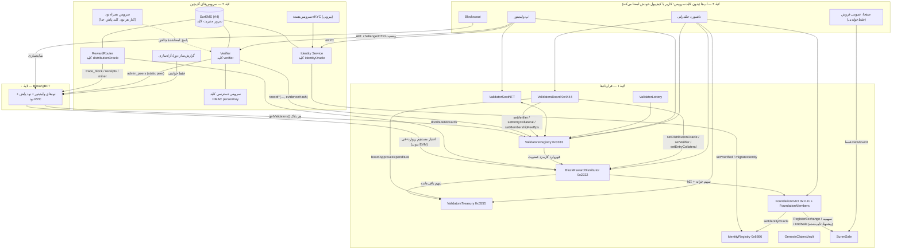
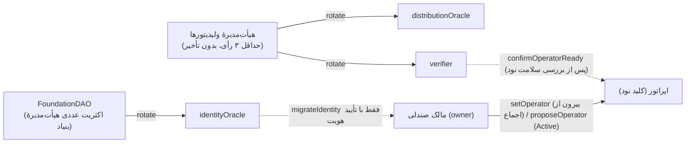

# معماری آن‌چین و آف‌چین شبکهٔ سور — طرح بلاک‌چین نسخهٔ ۲٫۵

> **وضعیت پیاده‌سازی (۲۰۲۶-۱۱-۱۹):** از طرح ۲٫۵ این بخش‌ها اکنون در `contracts/` نوشته و با ۹۷ آزمون Hardhat در ۱۰ فایل (روی EVM درون‌فرایندی Hardhat، نه Besu/QBFT) آزموده شده‌اند: `FoundationDAO` (با نوع آزاد `Execute` و `EndSale`)، `FoundationMembers`، `SurenSale` (مدل صرافی، بدون اوراکل پرداخت)، `ValidatorLottery`، `GenesisClaimsVault` (صندوق طلب‌ها؛ ۲۴ قسط ماهانه)، حذف ولیدیتور در بازیابی شبکه (`RemovedInRecovery`)، تغییرات `IdentityRegistry` (بله/ایمیل، `isFullyVerified`)، `ValidatorSeatNFT` (صندلی ERC-721 با انتقال و قواعد خریدار)، هستهٔ بازطراحی `ValidatorsRegistry`/`ValidatorsBoard` (وثیقهٔ ثابت، کلید مالک/اپراتور، جریان مؤسسان، `SelfSuspended`، سوزاندن ۱۰۰٪ جریمه، قواعد فاصلهٔ ورود) و سوزاندن مازاد پاداش در `BlockRewardDistributor`. هنوز نوشته نشده‌اند: `RewardRouter` (سرویس آف‌چین، نه قرارداد)، سرویس‌های Verifier و Identity، ابزار genesis، بررسی‌های آف‌چین Verifier برای تعلیق داوطلبانه و ازسرگیری، و حدود تغییر ریوارد (±۱۰٪ و ۶ ماه فاصله؛ در `proposeRateChange` هنوز نیست). پوشه‌های `contracts/` و `contracts-fa/` فقط نسخهٔ جاری را نگه می‌دارند؛ نسخه‌های قدیمی در git هستند (برچسب [`v2.2.0`](https://github.com/Sur-network/sur-new/releases/tag/v2.2.0)). ✅ دور اول آزمون زندهٔ Besu برای قراردادهای ۲٫۵ انجام شد (۲۰۲۶-۱۱-۱۹؛ Besu 26.9.0 در Docker، QBFT، فورک London، یک میزبان، اجراهای کوتاه؛ ۲۲ فایل نتیجه؛ دو اجرای اول به‌علت اشکال اسکریپت ناموفق ثبت و نگه داشته شده‌اند، بقیه گذشتند): `testing-evidence/besu-live-test-v25-2026-11-19/REPORT.md`. 🔶 هنوز روی Besu اجرا نشده: هر تایمر ۷۲ ساعت و بیشتر (قفل ۹۰ روزه، انقضا و ارجاع ۷روزه، دورهٔ آزمایشی و مهلت ورود با مقدار واقعی)، آزادسازی ماهانهٔ صندوق طلب‌ها، `recordSuspension`/رخداد جمعی/جریمه/اعتراض/`recordRecovery`، لاتاری دوم، تازه‌سازی ماهانهٔ هیأت، حکمرانی نرخ ریوارد، گذار Shanghai/Cancun، `SurenSale`، `ServiceStaking` و خرج خزانه؛ یافته‌های باز F-1 تا F-7 در `sur-master-open-items.md` بخش ۵. حسابرسی امنیتی هم انجام نشده است؛ این نتیجه آمادگی تولید نیست. نام توابع و پارامترها در این سند هرجا با کد مخزن یا با سند مرجع قراردادها فرق کند، **کد** و سپس **سند مرجع قراردادها** معتبر است.

> نام توابعِ بخش‌های پیاده‌شده همان نام کد است؛ نام توابعِ بخش‌های ننوشته (RewardRouter و سرویس‌های آف‌چین) موقت است؛ NFT صندلی و هستهٔ Registry/Board اکنون در کد هستند.

> **مخاطب:** مهندسان، ممیزان امنیتی و شرکای فنی. این سند «مرز آن‌چین/آف‌چین» را برای هر سامانه می‌کشد: چه چیزی در قرارداد است، چه چیزی بیرون از زنجیره است، به چه کسی اعتماد می‌شود، و اگر بخش آف‌چین از کار بیفتد چه می‌شود.
>
> **مکمل (نه تکرار):** برای تصمیم‌های معماری سطح‌بالا → [`sur-blockchain-design-doc.md`](sur-blockchain-design-doc.md)؛ برای هر تابع/ثابت/پارامتر → [`sur-smart-contracts-reference.md`](sur-smart-contracts-reference.md)؛ برای دیپلوی در genesis → [`sur-contracts-deploy-notes.md`](sur-contracts-deploy-notes.md)؛ برای اوراکل‌ها و آدرس‌ها → [`sur-contracts-oracles-accounts-report.md`](sur-contracts-oracles-accounts-report.md). مشخصات سرویس‌ها: [`../offchain-services/`](../offchain-services/) (فهرست نرم‌افزارها: [`sur-software-inventory.md`](../offchain-services/sur-software-inventory.md)). ماتریس «چه کسی پیشنهاد می‌دهد/تأیید می‌کند/اجرا می‌کند» فقط در [`../parties/01-interaction-matrix.md`](../parties/01-interaction-matrix.md) است و اینجا تکرار نمی‌شود.

> ✅🔶 **وضعیت آزمون Besu:** دور اول آزمون زندهٔ Besu برای ۲٫۵ انجام شد (۲۰۲۶-۱۱-۱۹؛ Besu 26.9.0 در Docker، QBFT حالت قرارداد، بلاک ۲ ثانیه، فورک London، یک میزبان، اجراهای کوتاه؛ `testing-evidence/besu-live-test-v25-2026-11-19/`؛ ۲۲ فایل نتیجه) و بخش بزرگی از ویژگی‌ها گذشت؛ ۹۷ آزمون Hardhat جدا و روی EVM درون‌فرایندی‌اند و در آن دور دوباره اجرا نشدند. BG-06 (انتقال صندلی) قاعدهٔ قبلی (تعلیق هنگام انتقال) را آزمود؛ دور 1b (BH-06A/BH-06B) آن را برای قاعدهٔ جدید «صندلی فعال فعال می‌ماند» دوباره اجرا کرد و گذشت. در هر ردیف، «روی Besu» یا به دور اول ۲٫۵ (شناسهٔ BG-…) برمی‌گردد یا، برای کد ۲٫۲، به دورهای قبلی (آخرین: دور ششم، Shanghai/Cancun، تک‌میزبان). 🔶 روی Besu اجرا نشده: هر تایمر ۷۲ ساعت و بیشتر، آزادسازی ماهانهٔ صندوق طلب‌ها، `recordSuspension`/رخداد جمعی/جریمه/اعتراض/`recordRecovery`، لاتاری دوم، تازه‌سازی ماهانهٔ هیأت، حکمرانی نرخ ریوارد، گذار Shanghai/Cancun، `SurenSale`، `ServiceStaking` و خرج خزانه؛ ابزار genesis تولیدی، RewardRouter، Verifier و حسابرسی هم هنوز وجود ندارند. یافته‌های باز دور اول: F-1 (خطای `Failed validator smart contract call` در لاگ Besu، ۸ بار در حدود ۱٬۱۰۰ بلاک؛ پایش و بررسی upstream)، F-2 (`extraData` در حالت `contract` فهرست ولیدیتور ندارد)، F-4 (انتساب بلاک‌های پیش از انتقال صندلی؛ ✅ تصمیم مالک ۲۰۲۶-۱۱-۱۹: بازپخش رویداد در Router)، ✅ F-5 (`setOperator` به نود خاموش پذیرفته می‌شد و زمان بلاک را کند می‌کرد؛ تصمیم مالک ۲۰۲۶-۱۱-۱۹ = تعویض دومرحله‌ای برای ولیدیتور `Active`: `proposeOperator` سپس `confirmOperatorReady` توسط Verifier؛ در کد و آزمون Hardhat؛ ⚠️ BG-03 قاعدهٔ قدیمی را آزمود و مسیر جدید باید روی Besu دوباره آزموده شود؛ 🔶 SLA تأیید Verifier)، F-6 و F-7. این آمادگی تولید نیست.

## راهنمای خواندن

| نشانه | معنا |
|---|---|
| 🔶 | مورد باز / تصمیم‌نگرفته (همان‌جا که مطرح می‌شود؛ با یک پرسش کوتاه) |
| ⏸️ | ظرفیت آینده (فعلاً اجرا نمی‌شود؛ زیرساخت نباید مانع شود) |
| ❌ | مشخصات یا برنامه وجود ندارد |
| «سهم آن‌چین/آف‌چین» | **برآورد مهندسی** از اینکه چه کسری از «قواعد و حالت» آن سامانه در قرارداد است و چه کسری بیرون از زنجیره؛ اندازه‌گیری کد نیست و فقط برای جهت‌دهی به بحث اعتماد است. همیشه کنارش فهرست مشخص آمده و فهرست مرجع است، نه عدد. |
| وضعیت | **کد ۲٫۲ + افزوده‌های ۲٫۵** (فایل در `contracts/` هست) / **✅ کد و آزمون Hardhat ۲٫۵** (نوشته‌شده؛ وضعیت Besu هر ردیف جدا آمده است) / **برنامه‌ریزی ۲٫۵** (طرح قطعی، کد ننوشته) / **🔶 مشخصات ناقص یا نبود** |

---

## ۱. نقشهٔ لایه‌ها

### ۱.۱ چهار لایه

| لایه | اجزا | چه کسی اجرا/نگه‌داری می‌کند |
|---|---|---|
| **۰ — شبکه (Besu/QBFT)** | Hyperledger Besu (نسخهٔ آزمون‌شده `v26.9.0`)، اجماع QBFT، `chainId` ۲۶۲، بلاک هر ۳ ثانیه، RPC عمومی بدون احراز، `validatorselectionmode: contract` به آدرس `0x3333…3333`، `miningbeneficiary` = `0x2222…2222`، `zeroBaseFee=true` | هر ولیدیتور نود خودش را؛ نودهای پایش/RPC سرویس‌ها زیر نظر هیأت‌مدیرهٔ ولیدیتورها |
| **۱ — قراردادها** | **ده قرارداد ساختاری** در `alloc` بلاک genesis با آدرس ثابت و بدون constructor: `FoundationDAO`، `BlockRewardDistributor`، `ValidatorsRegistry`، `ValidatorsBoard`، `ValidatorsTreasury`، `IdentityRegistry` (شش قرارداد با آدرس‌های ثابت `0x1111…` تا `0x6666…`) + چهار قرارداد تازهٔ ۲٫۵: `FoundationMembers`، `ValidatorSeatNFT`، `GenesisClaimsVault`، `ValidatorLottery` (آدرس‌های **پیشنهادی** در `SurAddresses.sol`: `0x7777…7777`، `0x8888…8888`، `0x9999…9999`، `0xaAaA…aAaA`؛ از این چهار `FoundationMembers`، `ValidatorLottery` و `GenesisClaimsVault` کد دارند). **غیرساختاری (دیپلوی عادی پس از genesis):** `SurenSale` و `ServiceStaking` (و دپ مرجع اختیاری `SurZether` که در این سند نیست) | بدون ادمین؛ هیچ کلید مرکزی پس از genesis روی قراردادها اختیار ندارد |
| **۲ — سرویس‌های آف‌چین** | RewardRouter، Verifier (+ سرویس دسترسی کلید `personKey`)، Identity Service + eKYC (سرویس‌دهندهٔ بیرونی)، سرویس همراه نود (`SUR_NODE_CHECK_V1`)، ابزار ساخت genesis، ابزار بازیابی اضطراری، گزارش‌ساز دورهٔ آزادسازی، Blockscout، سرور مدیریت کلید SurKMS (A4)، نودهای پایش و RPC | توسعه: کمیتهٔ فنی بنیاد؛ اجرای Verifier و RewardRouter: هیأت‌مدیرهٔ ولیدیتورها؛ eKYC/Identity: کمیتهٔ فنی بنیاد ولی مستقل؛ گزارش‌ها: کمیتهٔ توسعهٔ کسب‌وکار؛ Blockscout: 🔶 (مسئول مشخص نیست) |
| **۳ — اپ‌ها و دپ‌ها** | اپ ولیدیتور، داشبورد حکمرانی، صفحهٔ عمومی فروش، اپ احراز هویت عمومی (❌ سند ندارد)، دپ‌های ثالث | کمیتهٔ فنی (اپ‌ها)، کمیتهٔ توسعهٔ کسب‌وکار (محتوای صفحهٔ فروش)، دپ‌های ثالث: صاحبانشان |

> نکتهٔ ضروری: **سورن ارز بومی** زنجیره است (نه توکن ERC20)؛ همهٔ جابه‌جایی‌ها با `msg.value`/`.call{value:…}` انجام می‌شود. تنها استثنا `FoundationDAO` است که می‌تواند ERC20 دیگر را هم جابه‌جا کند.

### ۱.۲ نمودار جریان داده و کلید

**کلیدها و چرخش (چه کسی کلید چه کسی را عوض می‌کند):**

### ۱.۳ آنچه روی لایهٔ پروتکل است، نه قرارداد

این‌ها **آن‌چین به‌معنای قرارداد نیستند** ولی بخشی از «حقیقت شبکه»‌اند و تغییرشان هماهنگی اپراتورهاست:

| مورد | مقدار/رفتار | تغییر و ریسک |
|---|---|---|
| `blockreward` واقعی | ۲ سورن در هر بلاک (`"2000000000000000000"`)؛ پیش‌فرضش صفر است و باید صریح بیاید | فقط با `transitions.qbft` + توقف و راه‌اندازی هماهنگ همهٔ نودها («coordinated fork»)؛ در Shanghai/Cancun کلید `block` یک **timestamp** است و باید دقیقاً برابر «زمان اثر» مصوب قرارداد باشد؛ نودی که transition را نداشته باشد در بلاک گذار رد می‌شود (`World State Root does not match`). 🔶 رویهٔ اپراتوری و مسئول بررسی هماهنگی همهٔ نودها تعیین نشده |
| مقدار مصوب ریوارد | در `BlockRewardDistributor` است | ±۱۰٪ هر تصمیم، حداقل ۶ ماه فاصله، ۶ ماه اول ممنوع، اثر یک هفته پس از تصمیم؛ مازاد واقعی بر مصوب سوزانده می‌شود؛ پاداش کمتر از مصوب را قرارداد نمی‌بیند (هشدار آف‌چین) |
| `gasPrice`/`min-gas-price` | `10^14` wei (۰٫۰۰۰۱ سورن به‌ازای هر گس)؛ انتقال ساده ۲۱٬۰۰۰ گس = ۲٫۱ سورن | هیچ مسیر رأی ندارد؛ فقط با به‌روزرسانی شبکه. ⏸️ ابزار عملیاتی تنظیم `min-gas-price` برای اپراتور فعلاً اجرا نمی‌شود |
| `zeroBaseFee=true` | کل فی به `miningbeneficiary` می‌رود؛ ۳۰٪ را قرارداد می‌سوزاند | پروتکل چیزی نمی‌سوزاند |
| `shanghaiTime`/`cancunTime` | هر دو در genesis فعال (آزموده با ۰ و ۰)؛ کتابخانه‌های آف‌چین باید `withdrawals`، `PUSH0` و سرایند Cancun را بخوانند | مقادیر تولیدی دیگر آزموده نشده؛ دور اول آزمون ۲٫۵ فقط London بود |
| انتخاب ولیدیتور | `contract` روی `0x3333…3333`؛ برمی‌گرداند **آدرس اپراتور** | بازگشت اضطراری به `blockheader` در Shanghai/Cancun با timestamp در آزمون زنجیره را متوقف کرد ❌ (بخش ۳٫۱۹) |
| پنجرهٔ state | Bonsai: خارج از حدود ۵۱۲ بلاک اخیر `eth_getBalance` → `null` و `trace_block` → `[]` **بدون خطا** | RewardRouter باید داده را «در دسترس نیست» بخواند نه «صفر» (بخش ۳٫۵) |
| فیلتر تراکنش بر پایهٔ احراز هویت | **وجود ندارد** (تصمیم قطعی)؛ کنترل در سطح دپ‌هاست | ⏸️ بلوکه‌کردن یک حساب در نودهای ولیدیتوری: تأیید نشده؛ زیرساخت نباید مانع شود |

---

## ۲. اصل‌های مرزبندی (چرا هر چیز آن‌طرف خط افتاده)

۱. **پول و حق روی زنجیره است:** وثیقه، پاداش، رأی، مالکیت صندلی، جریمهٔ سوزانده‌شده، خرج خزانه‌ها، فروش و آزادسازی طلب‌ها همه در قرارداد قاعده و حالت دارند و هیچ سرویسی نمی‌تواند آن‌ها را دور بزند.
۲. **مشاهده روی زنجیره نیست:** «آیا نود واقعاً روشن است»، «آیا تلفن این شخص مال خودش است»، «کدام بلاک را چه کسی ساخت و چقدر ریوارد/فی بود» را قرارداد نمی‌تواند ببیند یا به‌صرفهٔ گس نمی‌تواند حساب کند؛ پس **یک سرویس آف‌چین مشاهده می‌کند و فقط نتیجه/تصمیم را با `evidenceHash` ثبت می‌کند**. مرز اعتماد همین‌جاست: قرارداد درستی ادعا را بررسی نمی‌کند، فقط بازه، صلاحیت، سقف و وضعیت را.
۳. **داده‌ی شخصی هرگز روی زنجیره نمی‌آید:** نه کد ملی، نه تلفن، نه تلگرام/بله/ایمیل، نه IP/`nodeID`، نه `personKey`. روی زنجیره فقط پرچم بولی، نام و نوع شخصیت خوداظهاری، و یک `commitment` هش‌شده برای دعاوی حقوقی. (حتی پارامتر ورودی تراکنش «تطبیق» در calldata عمومی می‌ماند، پس «تطبیق» همیشه API آف‌چین است.)
۴. **تصمیم‌های وضعیت روی زنجیره، رصد روتین بیرون:** هیچ تراکنش «هر ساعت برای هر ولیدیتور» نیست؛ فقط وقتی وضعیت واقعاً عوض می‌شود تراکنش می‌رود. بقیهٔ چرخه‌ها فقط `liveness_log` محلی‌اند.
۵. **هر سرویس آف‌چین نقطهٔ اعتماد است و باید قابل‌چرخش و قابل‌رصد باشد:** کلیدش در SurKMS، چرخشش با نهاد مشخص و فوری، خرابی‌اش هرگز به تنبیه خودکار نادرست نینجامد (تصمیم C01).
۶. **نبود ادمین:** قراردادهای ساختاری آدرس هم را `constant` می‌شناسند؛ هیچ proxy یا کلید ارتقا نیست (بخش ۶).

---

## ۳. بلوک سامانه‌ها

قالب هر بلوک: آن‌چین ‖ آف‌چین ‖ اعتماد ‖ کلید/اوراکل ‖ جریان داده ‖ خرابی ‖ حریم خصوصی ‖ وضعیت.

### ۳.۱ ثبت و عضویت ولیدیتورها — `ValidatorsRegistry` (`0x3333…3333`)

| محور | شرح |
|---|---|
| **آن‌چین (≈۷۵٪)** | **حالت:** وضعیت هر ولیدیتور (`None → Probation → Active ↔ Demoted`، `Active ↔ SelfSuspended`، `Exiting`، و ✅ `RemovedInRecovery` که در کد نوشته شده است)، مالک/اپراتور (یک‌به‌یک و دائمی یکتا)، وثیقه، `activationSeq`، `everActivated`، `statusNonce` و `wasActiveAt` (برای واجدان رأی). **قواعد:** ورود با پرداخت دقیقاً `entryCollateral` (۵۰۰٬۰۰۰ سورن؛ بازهٔ ۱۰۰٬۰۰۰ تا ۲٬۰۰۰٬۰۰۰) + کارمزد عضویت (۴٪ وثیقه = ۲۰٬۰۰۰ سورن؛ بازهٔ ۱٪ تا ۱۰٪) یعنی ۵۲۰٬۰۰۰ سورن؛ شرط `kycVerified` و `Individual` برای غیرمؤسس؛ فاصلهٔ ورود (حداکثر یک ورود در هر ۷ روز؛ در کد شمارش از لحظهٔ درخواست، طرح قبلی فعال‌سازی بود؛ مؤسسان و برندگان لاتاری مستثنی)؛ کف `MIN_ACTIVE_VALIDATORS = 1`؛ تعلیق داوطلبانه و ازسرگیری؛ خروج دائم با cooldown ۷ روزه و `withdrawStake`؛ مسیر جریمه: ثبت پرونده (`slashBps` = ۱٪ وثیقه) ← تحویل شواهد ← اعتراض ۷۲ ساعته ← رأی مجمع (اکثریت ساده، مهلت ۷ روز، نبود نصاب = رد جریمه) ← **سوزاندن ۱۰۰٪ به `address(0)`** فقط پس از گذشت مهلت بدون اعتراض یا رد/تأیید؛ معافیت جمعی (بیش از ۲۰٪ مجموعه در پنجرهٔ ۱ ساعته)؛ شش پارامتر `ParamKey` با رأی کامل ولیدیتورها. ✅ **حذف در بازیابی شبکه (کد + آزمون Hardhat):** `recordRecoveryRemoval(validator, recoveryTimestamp, evidenceHash)` فقط Verifier (ولیدیتور باید `Active` باشد؛ `recoveryTimestamp` نه در آینده و نه قدیمی‌تر از ۳۰ روز — 🔶 ثابت `RECOVERY_RECORD_MAX_AGE`؛ شواهد ناتهی؛ مجموعهٔ فعال باید بالاتر از `MIN_ACTIVE_VALIDATORS` بماند)؛ بدون جریمه؛ وثیقه تا `recoveryTimestamp + ۹۰ روز` قفل؛ ممنوعیت دائمی؛ اعتراض ۷۲ ساعته با `objectRecoveryRemoval()`؛ تصمیم با `ValidatorsBoard` (۳ رأی، موضوع رأی نمی‌دهد) یا — اگر کمتر از ۳ عضو دیگر اختیار دارند — مجمع ولیدیتورها (دوسوم، با `referRecoveryRemovalToAssembly`)؛ پنجرهٔ ۷ روزه؛ نبود تصمیم = لغو و بازگشت ولیدیتور (`expireRecoveryRemoval`)؛ `requestExit()` فقط پس از تعیین تکلیف پرونده و گذشتن ۹۰ روز. ✅ `enterAsLotteryWinner(address)` فقط لاتاری: صندلی `Probation` بدون وثیقه/کارمزد، پرداخت‌کنندهٔ ورودی شمرده نمی‌شود. **رویدادها:** تصمیم‌های وضعیت، سوزاندن جریمه، تغییر پارامتر. فراخوانی بهترین‌تلاش `ValidatorsBoard.syncVoter` در هر تغییر وضعیت (سقف گس ۶۰۰٬۰۰۰؛ شکستش تغییر وضعیت را متوقف نمی‌کند) |
| **آف‌چین (≈۲۵٪)** | رصد سلامت/همگامی نود اپراتور (از `admin_peers`، نه از RPC نودِ متقاضی)؛ نسبت موفقیت ≥۹۵٪ در دورهٔ probation (۱ هفته) و بازگشت (۴۸ ساعت)؛ آستانهٔ ۴ ساعت غیرفعالیِ تأییدشده؛ احراز تلفن/تلگرام/بله/ایمیل؛ یکتایی شخص و ممنوعیت بازگشت (`personKey`)؛ شرط حضور فیزیکی نود در ایران (IP-geolocation)؛ بستهٔ شواهد رمزگذاری‌شده؛ (اگر شمارش فاصلهٔ ورود به فعال‌سازی برگردد) زمان‌بندی فعال‌سازی‌ها برای رعایت فاصلهٔ ورود — همه در سرویس Verifier (بخش ۳٫۶) |
| **اعتماد** | یک Verifier تصمیم‌گیر (تصمیم P03؛ چندناظری/«دو از سه» نداریم) با اختیار فقط ثبت `record*`. قرارداد درستی شواهد را نمی‌بیند؛ مهارها: تحویل شواهد + اعتراض ۷۲ ساعته + رأی مجمع + معافیت جمعی + کف ولیدیتور فعال + سقف جریمه ۱٪ وثیقه + چرخش کلید `verifier` توسط هیأت |
| **کلید/اوراکل** | `verifier` (SurKMS) برای `recordActivation`/`recordSuspension`/`recordRecovery`/`recordPreExitViolation`/`recordResume`/`recordRecoveryRemoval` و تأیید ورود مؤسس و تأیید تعویض اپراتور ولیدیتور `Active` (`confirmOperatorReady`)؛ هر ولیدیتور: **مالک** (وثیقه، ریوارد، رأی، هویت، خروج، NFT، `setOperator`/`proposeOperator`/`cancelOperatorChange`) و **اپراتور** (فقط امضای بلاک) |
| **جریان داده** | ورودی: `requestMembership` (مالک، `payable`)، `record*` (Verifier)، `setEntryCollateral`/`setMembershipFeeBps`/`setVerifier` (فقط Board)، `onSeatTransferred` (NFT)، `enterAsLotteryWinner` (لاتاری). خروجی: `getValidators()` به Besu؛ `everActivated`/مالک‑اپراتور به Distributor؛ `receiveMembershipFee` به Distributor؛ `syncVoter` به Board؛ رویدادها به Verifier/داشبورد |
| **خرابی** | **Verifier از کار بیفتد:** هیچ فعال‌سازی، تعلیق، بازگشت یا ازسرگیری‌ای ثبت نمی‌شود؛ ولیدیتورهای `Active` به تولید بلاک ادامه می‌دهند؛ هیچ تعلیق نادرستی ثبت نمی‌شود (حفرهٔ مشاهده تخلف فردی نیست). **ثبت‌نام جدید می‌تواند وثیقه قفل کند ولی از probation نگذرد.** **ولیدیتور «فانتوم» فعال شود** (آدرس بی‌نود) → هر نوبتش یک تأخیر `requesttimeoutseconds` و اگر نصاب QBFT (`⌊2n/3⌋+1`) از نودهای واقعی بیشتر شود، **زنجیره قفل می‌شود** (در آزمون ~۵۴ دقیقه) — پیش‌شرط ایمنی فعال‌سازی باید در Verifier پیاده شود |
| **حریم خصوصی** | روی زنجیره: آدرس مالک/اپراتور، وضعیت، وثیقه (همه عمومی). هرگز: تلفن، تلگرام، بله، ایمیل، `nodeID`/IP، `personKey` |
| **وضعیت** | ✅ کد و ۲۰ آزمون Hardhat (`ValidatorsRegistry.test.js`) برای هستهٔ ۲٫۵ + `RemovedInRecovery`/`recordRecoveryRemoval` و `enterAsLotteryWinner`: وثیقهٔ ثابت `entryCollateral` (۵۰۰٬۰۰۰ سورن؛ منحنی رشد حذف)، `setEntryCollateral`/`setMembershipFeeBps` فقط از Board (±۱۰٪، حدود مطلق، تایمر مشترک ۱۸۰ روزه)، کلید مالک/اپراتور (`requestMembership(operator)`، `setOperator` فوری بیرون از مجموعهٔ اجماع، تعویض دومرحله‌ای ولیدیتور `Active` با `proposeOperator`/`confirmOperatorReady`/`cancelOperatorChange` و انقضای ۷روزه، `operatorOf`، `ownerOfOperator`، `getValidators()` = اپراتورها، `getActiveOwners()` = مالک‌ها)، ورود پله‌ای مؤسسان (فقط اولین ولیدیتور `Active`؛ بقیه `Probation`، `isFounder`، بدون انتظار دورهٔ آزمایشی)، `SelfSuspended` (`selfSuspend`، `requestResume`، `recordResume`)، سوزاندن ۱۰۰٪ جریمه (`totalSlashBurned`)، فاصلهٔ ورود (۷ روز؛ شمارش در لحظهٔ درخواست) و قیدهای `EntryWindowSeconds`، و `onSeatTransferred`/`acceptSeatTransfer`. ⚠️ runtime حدود ۳۶٬۸۷۹ بایت (اندازهٔ فعلی) و بزرگ‌تر از سقف ۲۴٬۵۷۶ بایت CREATE است؛ چون با `alloc` تزریق می‌شود روی زنجیرهٔ واقعی سقف اعمال نمی‌شود (✅ روی Besu تأیید شد، دور اول BR-SIZE: ۳۴٬۶۰۵ بایت کار کرد و باید با اندازهٔ فعلی دوباره تأیید شود؛ آزمون‌های Hardhat سقف را برمی‌دارند). 🔶 نقطهٔ دقیق بررسی فاصلهٔ ورود: در کد لحظهٔ درخواست است، تأیید مالک لازم است؛ 🔶 اینکه اعمال ممنوعیت بازگشت (`personKey`) فقط «عدم تأیید Verifier» است یا قرارداد هم چیزی ثبت می‌کند؛ ✅ روی Besu آزموده شد (دور اول ۲۰۲۶-۱۱-۱۹: BG-01 تا BG-07، BG-12، BG-13 — شروع تک‌ولیدیتوری و ورود پله‌ای تا ۷ در حالت `contract`، `getValidators` روی کلید اپراتور، تعویض فوریِ اپراتور (BG-03، قاعدهٔ قدیمی؛ مسیر دومرحلهٔ جدید باید دوباره روی Besu اجرا شود)، ورود پولی و چرخهٔ ورود با تایمرهای کوتاه آزمایشی، `SelfSuspended`، انتقال صندلی با قاعدهٔ قبلی — دور 1b با BH-06A/BH-06B قاعدهٔ فعلی را دوباره اجرا کرد و گذشت، حذف در بازیابی تا ۳ رأی هیأت)؛ ✅ F-4 (انتساب بلاک‌های پیش از انتقال صندلی؛ تصمیم مالک: بازپخش رویداد در Router) و ✅ F-5 (`setOperator` به نود خاموش؛ با تعویض دومرحله‌ای برای `Active` در کد بسته شد؛ روی Besu باید دوباره آزموده شود)؛ 🔶 اجرانشده: قفل ۹۰روزه، انقضای ۷روزه، ارجاع به ولیدیتورها، دورهٔ آزمایشی و مهلت ورود ۷روزه با مقدار واقعی، `recordSuspension`/جریمه/اعتراض/`recordRecovery` |

### ۳.۲ هیأت‌مدیرهٔ ولیدیتورها — `ValidatorsBoard` (`0x4444…4444`)

| محور | شرح |
|---|---|
| **آن‌چین (≈۹۵٪)** | ۵ صندلی؛ رأی تأییدی مستمر (هر ولیدیتور فعال حداکثر ۵ رأی، با کلید مالک، قابل‌پس‌گرفتن)؛ شمارندهٔ افزایشی رأی (`voteCount`)؛ `refreshBoard` بدون مجوز: هر ماه میلادی (UTC) یک‌بار؛ ۵ ولیدیتور `Active` پررأی؛ شکستن تساوی با `activationSeq` کمتر؛ قطع فوری اختیار عضو با درخواست خروج + جانشینی (`syncBoard`/`fillVacancies`)؛ `clearStaleVotes` (`Demoted`: پس از `recoveryPeriod + ۳۰ روز`؛ `SelfSuspended`: ۳۰ روز از شروع تعلیق داوطلبانه؛ تصمیم ۲۰۲۶-۱۱-۱۹)؛ اقدامات: چرخش `distributionOracle`، چرخش `verifier`، تصویب پرداخت خزانه، تغییر `entryCollateral` و `membershipFeeBps` — همه حداقل ۳ رأی؛ ابطال خودکار اقدام‌های ناتمام با تغییر ترکیب؛ انقضای اقدام ۱۴ روز؛ پیش‌نیاز رأی: `hasIdentity`. ✅ رسیدگی به اعتراض حذف در بازیابی (کد): `voteRecoveryRemoval(validator, uphold)` (۳ رأی برای هر طرف؛ موضوع رأی نمی‌دهد)، `referRecoveryRemovalToAssembly(validator)` (هرکسی، وقتی کمتر از ۳ عضو دیگر اختیار دارند)، `voteRecoveryAssembly(validator, uphold)` (ولیدیتورهای `Active` هنگام ارجاع؛ ⌈۲n/۳⌉ برای تأیید؛ لغو وقتی تأیید دیگر ممکن نیست) |
| **آف‌چین (≈۵٪)** | فقط رابط (داشبورد حکمرانی) و فراخوانی‌های راحتی (Verifier ماهی یک‌بار `refreshBoard`/`syncBoard`/`fillVacancies` را هم می‌زند ولی هرکس دیگری هم می‌تواند) |
| **اعتماد** | سه از پنج عضو می‌توانند کلید `distributionOracle` و `verifier` را عوض کنند — یعنی **عملاً مالک کلیدهای عملیاتی شبکه‌اند**. تعدیل: ترکیب هر ماه با رأی همهٔ ولیدیتورهای فعال عوض می‌شود؛ مسیر عزل اضطراری نیست؛ اگر دارندگان اختیار <۳ شوند، پرداخت، چرخش کلید و تغییر وثیقه/کارمزد متوقف می‌شود؛ **حداقل ۳ رأی کاهش نمی‌یابد**؛ تعلیق به‌تنهایی اختیار را قطع نمی‌کند ولی عضو معلق در انتخاب ماه بعد واجد نیست؛ عضو هیأت نمی‌تواند `selfSuspend` کند |
| **کلید/اوراکل** | کلید مالک هر ولیدیتور (رأی و اقدام). کلید سرویس ندارد |
| **جریان داده** | ورودی: `voteFor/unvoteFor`، `refreshBoard`، `syncVoter(s)` از Registry. خروجی: `setDistributionOracle` (Distributor)، `setVerifier`/`setEntryCollateral`/`setMembershipFeeBps` (Registry)، `boardApproveExpenditure` (Treasury) |
| **خرابی** | کسی `refreshBoard` نزند: هیأت ماه قبل اختیار ندارد تا نخستین فراخوان ماه تازه (هیأت خالی هر زمان قابل‌پرشدن است) — ریسک «ماه بی‌هیأت» تا فراخوانی دلخواه کسی. هزینهٔ گس `refreshBoard` به تعداد نامزدهای دارای رأی وابسته است؛ اگر روزی مشکل‌ساز شد نسخهٔ صفحه‌بندی‌شده لازم است |
| **حریم خصوصی** | همه عمومی (رأی‌ها و اقدام‌ها). هویت حقیقی اعضا روی زنجیره نیست؛ فقط ثبت‌نام خوداظهاری (`hasIdentity`) |
| **وضعیت** | پایهٔ کد ۲٫۲ + ✅ افزوده‌های ۲٫۵ با آزمون Hardhat: رسیدگی به اعتراض حذف در بازیابی شبکه؛ تغییر وثیقه/کارمزد با ۳ از ۵ (`proposeSetEntryCollateral`، `proposeSetMembershipFeeBps`؛ اکشن‌های منحنی رشد قدیمی حذف شدند؛ هر دو دست‌کم ۳ رأی؛ آزموده با Board واقعی). ✅ تصمیم مالک ۲۰۲۶-۱۱-۱۹: عضو seed که `Probation` است کرسی دارد ولی عمل نمی‌کند (`_canAct`؛ `hasBoardAuthority` برایش `false`؛ `syncBoard()` حذفش نمی‌کند) تا Verifier فعالش کند؛ پس در genesis فقط ولیدیتور اول عمل می‌کند و اقدام هیأت دست‌کم ۳ عضو فعال‌شده می‌خواهد (دست‌کم ۲ مؤسس دیگر را زود فعال کنید)؛ `boardMonthId` و `boardVersion` باید در genesis ست و assert شود. روی Besu (دور اول): ✅ قید تعلیق داوطلبانه برای عضو هیأت و رسیدگی هیأت به حذف در بازیابی (۳ رأی تأیید یا لغو؛ BG-04، BG-07، BG-07b)؛ 🔶 `refreshBoard` ماهانه، `proposeSetEntryCollateral`/`proposeSetMembershipFeeBps` و ارجاع به مجمع اجرا نشد |

### ۳.۳ خزانهٔ ولیدیتورها — `ValidatorsTreasury` (`0x5555…5555`)

| محور | شرح |
|---|---|
| **آن‌چین (≈۹۵٪)** | نگه‌داری سورن؛ **تنها منبع ورودی: سهم باقی‌ماندهٔ ریوارد** (شروع ۳۵٪ از کل ریوارد؛ بازهٔ ۲۰٪ تا ۴۵٪) — نه جریمه (سوزانده می‌شود)، نه کارمزد عضویت؛ تنها مسیر خرج: `boardApproveExpenditure` فقط از `ValidatorsBoard` (حداقل ۳ رأی) زیر دو سقف **ثابت**: هر پرداخت ≤ ۵۰٬۰۰۰ سورن (خودِ سقف مجاز) و مجموع پنجرهٔ حدود ۳۰ روزه (سطل‌های روزانه) ≤ ۲۰۰٬۰۰۰ سورن؛ تغییر سقف: رأی مجمع ولیدیتورها + **تأخیر ۷ روزه** + `applyPendingCapChange` بدون مجوز؛ خرد کردن پرداخت راه دور زدن نیست |
| **آف‌چین (≈۵٪)** | فقط رابط (داشبورد: سقف‌های جاری، مصرف پنجره، پیشنهاد تغییر سقف). تحویل پرداخت‌شده‌ها و حسابداری بیرونی: 🔶 مسئول و رویه تعیین نشده |
| **اعتماد** | هیأت ۳ از ۵؛ مجمع فقط قواعد (سقف‌ها) را می‌گذارد، پرداخت موردی را تصویب نمی‌کند. بیشینهٔ زیان در بدترین حالت: ۲۰۰٬۰۰۰ سورن در هر ۳۰ روز |
| **کلید/اوراکل** | ندارد |
| **جریان داده** | ورودی: `receive()` از Distributor. خروجی: پرداخت به مقصد تصویب‌شده |
| **خرابی** | هیچ وابستگی آف‌چین ندارد؛ اگر اعضای دارای اختیار <۳ باشند خرج متوقف است (ولی موجودی امن می‌ماند). genesis: موجودی صفر؛ مقداردهی ۵۰٬۰۰۰/۲۰۰٬۰۰۰ در سورس اجرا نمی‌شود و ابزار genesis باید این دو slot را overlay کند |
| **حریم خصوصی** | کاملاً عمومی |
| **وضعیت** | کد ۲٫۲ موجود؛ ۲٫۵: تنها تغییر منبع ورودی (بدون اسلش) و هم‌خوانی با کلید مالک |

### ۳.۴ توزیع بلاک‌ریوارد — `BlockRewardDistributor` (`0x2222…2222`)

| محور | شرح |
|---|---|
| **آن‌چین (≈۵۰٪)** | **قواعد تقسیم** (ورود: گزارش `distributionOracle`): از ریوارد ۱۵٪ ثابت → `FoundationDAO`؛ سهم مستقیم ولیدیتورها (شروع ۵۰٪، حکمرانی‌شونده در بازهٔ ۴۰٪ تا ۶۵٪، فاصلهٔ ۱۸۰ روز) به‌نسبت تعداد بلاک؛ باقی → خزانه (شروع ۳۵٪)؛ از فی عادی ۳۰٪ سوزانده، ۷۰٪ + ۱۰۰٪ کارمزد عضویت انباشته (معاف از سوزاندن) به‌نسبت بلاک بین ولیدیتورها؛ هر ولیدیتور فقط یک انتقال ترکیبی؛ پرداخت به **کلید مالک**؛ خرده‌ریز به خزانه. **سقف و کنترل‌ها:** مقدار مصوب ریوارد (ثابت اولیه ۲ سورن + تاریخچهٔ تغییرها)؛ مازاد واقعی بر مصوب → فوراً `address(0)` + رویداد `RewardExcessBurned` (بدون سقف هر epoch)؛ کنترل بازهٔ P05 (`fromBlock = lastSettledBlock+1`، `toBlock < block.number`، مجموع بلاک‌ها ≤ طول بازه)؛ ترتیب صعودی آدرس‌ها (L07)؛ `everActivated`؛ `totalRewards + totalFees ≤ balance`؛ فاصلهٔ حداقل ۲۳ ساعت؛ حکمرانی نرخ (±۱۰٪ هر تصمیم، حداقل ۶ ماه، ۶ ماه اول ممنوع، اثر یک هفته پس از تصمیم، دومجلسی: هیأت ۳ از ۵ + رأی ولیدیتورهای واجد) و تغییر نسبت سهم مستقیم/خزانه (دومجلسی) |
| **آف‌چین (≈۵۰٪)** | **همهٔ محاسبهٔ ورودی:** کدام بلاک را چه کسی ساخت، چقدر ریوارد (`trace_block`) و چقدر فی (رسید تراکنش‌ها) در بازه بود، زمان‌بندی، ارسال و idempotency — سرویس RewardRouter (بخش ۳٫۵). **و پیکربندی Besu:** مقدار واقعی `blockreward` |
| **اعتماد** | قرارداد **صحت مبالغ و انتساب بلاک‌ها را اثبات نمی‌کند**؛ اوراکل اشتباه یا مخرب می‌تواند در بازهٔ معتبر عددهای غلط بدهد. حد زیان: فقط پولی که از آخرین تسویه در قرارداد انباشته شده (حدود یک epoch)، فقط به ولیدیتورهایی که `everActivated` دارند، و ریوارد حداکثر تا سقف مصوب بازه؛ مبلغ فی تا سقف موجودی قرارداد بدون اثبات. اوراکل نمی‌تواند نرخ را تغییر دهد. مهار: چرخش کلید توسط هیأت (۳ رأی، بدون تأخیر) |
| **کلید/اوراکل** | `distributionOracle`: `0xbCBAc7d286eA11EC57fb4e0f5D16d960D6d202b6` (EIP‑55، هاردکد در سورس به‌عنوان مقدار اولیه، قابل‌چرخش) |
| **جریان داده** | ورودی: ریوارد+فی از پروتکل (اعتبار مستقیم به state، **بدون** فراخوانی `receive()` و بدون رویداد)؛ `distributeRewards` (RewardRouter)؛ `receiveMembershipFee` (Registry). خروجی: پرداخت به مالکان، به `FoundationDAO`، به Treasury، سوزاندن |
| **خرابی** | RewardRouter از کار بیفتد: ریوارد در قرارداد می‌ماند و **هیچ ولیدیتوری پولش را نمی‌گیرد**؛ هیچ پولی گم نمی‌شود چون چرخهٔ بعد از `lastSettledBlock+1` همهٔ بلاک‌های جامانده را می‌پوشاند (قطعی سرویس با پرش رد نمی‌شود). **ریسک واقعی:** داده‌ی تاریخی — خارج از ~۵۱۲ بلاک Bonsai بی‌صدا `null`/`[]` برمی‌گردد (بازهٔ ۲۳ ساعته ≈ ۲۷٬۶۰۰ بلاک)؛ در دورهٔ ششم ۱۰۳ از ۴۷۰ بلاک یک بازه قابل‌اندازه‌گیری نبود. 🔶 تأمین داده (نود archive/FOREST یا جمع‌آوری لحظه‌ای) انتخاب نشده. مازاد: اگر Besu جدیدِ مصوب را در زمانی غیر از «زمان اثر» اعمال کند، پاداش بیش از مصوب سوزانده می‌شود و گذشتهٔ بازه برای همیشه با سقف مصوب سنجیده می‌شود |
| **حریم خصوصی** | عمومی؛ فقط آدرس مالک/مقدار |
| **وضعیت** | کد ۲٫۲ روی Besu آزموده (دور ششم، هش‌های ثبت‌شده؛ تک‌میزبان). ✅ ۲٫۵ با ۴ آزمون Hardhat و روی Besu در دور اول ۲۰۲۶-۱۱-۱۹ (BG-08a: حسابداری دقیق وقتی واقعی = مصوب؛ BG-08b: واقعی ۱٬۱۷۳ در برابر مصوب ۷۸۲، مازاد ۳۹۱ سوزانده شد): فقط مقدار مصوب (`min(گزارش‌شده، مصوب)`) تقسیم می‌شود و مازاد پیش از پرداخت‌ها به `address(0)` می‌رود (`_capAndBurnExcess`، `totalExcessBurned`، `RewardExcessBurned(epochId, fromBlock, toBlock, approvedRewards, excessBurned)`، بدون سقف در epoch؛ بازه همچنان تسویه می‌شود)؛ فرض «Router مقدار واقعی را گزارش دهد و قرارداد مازاد را حساب کند» بسته شد. ✅ نگاشت اپراتور↔مالک در Router با `Registry.ownerOfOperator` و بازپخش رویداد (کلید قدیمی برای تعویض اپراتور (`setOperator` یا `confirmOperatorReady`) به مالکش پیوسته می‌ماند، ولی پس از انتقال صندلی به خریدار اشاره می‌کند — F-4، تصمیم مالک ۲۰۲۶-۱۱-۱۹: Router رویدادهای `SeatTransferred`، `OperatorSet` و `OperatorChangeConfirmed` را از genesis بازپخش می‌کند، بدون رکورد تاریخچهٔ مالک در قرارداد؛ 🔶 نوشتن Router باقی است)؛ تسویهٔ بلاک‌های اپراتورِ تعویض‌شده در میانهٔ بازه با همین نگاشت؛ حدود ±۱۰٪/۶ ماه تغییر نرخ هنوز در `proposeRateChange` نیست؛ 🔶 آیا `certifyRateStart` در ۲٫۵ لازم است؛ اندازهٔ runtime اکنون ۲۰٬۶۷۱ بایت (سقف ۲۴٬۵۷۶)؛ 🔶 اجرانشده روی Besu: تغییر نرخ و گواهی ارتفاع شروع برای ۲٫۵، حالت واقعی < مصوب، گذار Shanghai/Cancun |

### ۳.۵ RewardRouter (اوراکل توزیع)

| محور | شرح |
|---|---|
| **آن‌چین (۰٪)** | هیچ؛ فقط یک فراخوان‌کنندهٔ مجاز (`distributionOracle`) |
| **آف‌چین (۱۰۰٪)** | دیمن خودکار Node.js/TypeScript (`viem`، `pino`) با SQLite (`epochs`، `epoch_txs`، `validator_epoch_shares`، `scan_progress`)، **بدون API عمومی و بدون رابط انسانی**؛ هر ~۲۳ ساعت و ۱۰ دقیقه: اسکن از `lastSettledBlock+1` تا آخرین بلاک مهرشده؛ `miner` هر بلاک (کلید اپراتور → مالک)؛ ریوارد از `trace_block` (نوع `reward`)؛ فی از `gasUsed × effectiveGasPrice` رسید هر تراکنش (**هرگز از trace**، چون `gasUsed` انتقال ساده در trace صفر گزارش می‌شود)؛ صلاحیت تولیدکننده در لحظهٔ تولید با `eth_call` تاریخی روی ارتفاع N−۱؛ تجمیع؛ پیش‌چک‌ها (`getDistributionOracle`، `timeUntilNextDistribution`، موجودی)؛ ارسال با ثبت پایدار پیش از broadcast |
| **اعتماد** | تنها مرجع محاسبه؛ **هیچ بازبین دومی نیست**. بازه‌های ناقص/مبهم (مجموع `blocksMined` ≠ طول بازه، یا صلاحیت تاریخی نامشخص حتی برای یک بلاک) → هیچ تراکنشی ساخته/ارسال نمی‌شود، هشدار، تکرار بعدی روی همان بازه (L08). تولید بلاک توسط فرد فاقد صلاحیتِ اثبات‌شده: گزارش استثنای جدا، بدون بازتوزیع خودکار 🔶 (سرنوشت پاداش آن بلاک تصمیم‌نگرفته) |
| **کلید** | `distributionOracle` در SurKMS، **کاملاً جدا** از `verifier` (slot و قاعدهٔ امضای مستقل)؛ اجرا زیر نظر هیأت‌مدیرهٔ ولیدیتورها، توسعه: کمیتهٔ فنی (که کلید ندارد) |
| **جریان داده** | ورودی فقط از RPC (نود با API `TRACE` فعال)؛ خروجی یک تراکنش هر epoch. هشدار آف‌چین مازاد/کسری پاداش |
| **خرابی** | RPC قطع: ۳ تلاش با backoff (۲/۴/۸ ثانیه) و رد چرخه؛ تراکنش revert: وضعیت `reverted` + پیجینگ فوری؛ crash در چهار پنجرهٔ مشخص (قبل/بعد از broadcast و mine) باید با restart دقیقاً یک تراکنش با همان nonce ایجاد کند (معیار پذیرش). **تراکنش با موجودی ناکافی برای `gasLimit × gasPrice` در آزمون بی‌صدا بیش از ۲۰ دقیقه در pool ماند** → پیش‌چک موجودی و هشدار «pending طولانی» لازم است. هزینهٔ هر توزیع در آزمون (قیمت آزمایشی ۱۰¹⁴ wei): ≈۹۴ تا ≈۱۳۶ سورن؛ کارمزد خودِ تراکنش به Distributor برمی‌گردد. 🔶 مقدار و روش تأمین موجودی گس حساب اوراکل و هشدار موجودی کم |
| **حریم خصوصی** | هیچ داده‌ی شخصی ندارد |
| **وضعیت** | **🔶 مشخصات کامل؛ برنامه نوشته نشده.** 🔶 آستانهٔ هشدار «پاداش واقعی کمتر از مصوب»؛ 🔶 داده‌ی تاریخی کافی؛ 🔶 اجرای ترکیبی زمان واقعی مسیر تغییر نرخ (حدود ۱۴ روز) انجام نشده؛ ✅ F-4 (دور اول آزمون Besu؛ تصمیم مالک ۲۰۲۶-۱۱-۱۹ = بازپخش رویداد): انتساب بلاک‌های پیش از انتقال صندلی با نگاشت جاری `ownerOfOperator` خطا دارد؛ Router رویدادهای `SeatTransferred`، `OperatorSet` و `OperatorChangeConfirmed` را از genesis بازپخش می‌کند (بدون رکورد تاریخچهٔ مالک؛ نیاز به تاریخچهٔ کامل رویدادها، ترتیب تعویض اپراتور (`setOperator`/`confirmOperatorReady`) و انتقال در یک بازه و موارد آزمون: `sur-reward-router-spec.md` بخش ۳ و ۱۰.۵)؛ 🔶 نوشتن Router باقی است؛ در آن دور Router واقعی وجود نداشت و انتساب با اسکریپت آزمون انجام شد (BG-08a) |

### ۳.۶ Verifier و بررسی liveness

| محور | شرح |
|---|---|
| **آن‌چین (≈۱۰٪؛ فقط پوسته)** | توابع `record*` با `onlyVerifier`؛ `resolveMassFailureCheck`، `assertDeliveryDisputed`، `executeUncontestedSlash`، `resolveAppealIfExpired` (بدون مجوز — Verifier فقط راحتی می‌دهد، تنها مسیر نیست) |
| **آف‌چین (≈۹۰٪)** | نگه‌داری داده‌ی حساس (تلفن/تلگرام/بله/ایمیل خام، `nodeID`، `personKey`)؛ API برای اپ ولیدیتور (چالش/OTP/وضعیت، احراز با امضای اتریومی، چالش کوتاه‌عمر)؛ چرخهٔ polling هر ۶۰ دقیقه (تصمیم قطعی؛ بدون وعدهٔ هشدار در «دقیقهٔ پانزدهم»؛ تعلیق ۴ ساعته در عمل بین ۴ تا ۵ ساعت)؛ نود پایش به‌عنوان static peer به همهٔ ولیدیتورها و `admin_peers`؛ نگاشت `nodeID ↔ آدرس` در پایگاه داخلی؛ IP-geolocation؛ قاعدهٔ نسخه‌دار `c01-rules-v1` (تعریف «موفق/نامشخص»؛ پیش‌نویس)؛ بستهٔ شواهد؛ هشدار آف‌چین سوزاندن مازاد (بخش ۶٫۹ مشخصات)؛ کارهای دوره‌ای بدون مجوز |
| **اعتماد** | **یک Verifier** (P03). نقطهٔ تمرکز اعتماد واقعی. نتیجهٔ «نامشخص» هرگز شکست نود نیست؛ قطعی عمومی یا خرابی پایش تخلف فردی نیست؛ سه سطح هشدار: ۱۵ دقیقه (اولیه)، ۱ ساعت (جدی)، ۴ ساعت (تعلیق) — همه در اولین بررسی بعدی. تشخیص موقعیت با VPN/پروکسی دورزدنی است (چک کمکی، نه اثبات؛ اجرای واقعی متکی بر تعهد ولیدیتور) |
| **کلید** | `verifier`: `0x1A5E86f3333291B3332C0f9Eddb04269940566bc`؛ در SurKMS با سرویس امضای جدا (remote signer، JSON-RPC با mTLS)؛ نمونه‌های polling فقط نتیجه را به signer می‌دهند؛ دی‌دوپلیکیشن در signer (پنجرهٔ ۵ دقیقه)؛ کلید HMAC `personKey` فقط پشت سرویس دسترسی کلید (فقط «HMAC این ورودی را حساب کن»). اگر Verifier setterهای هویت را هم صدا بزند باید کلید `identityOracle` را جدا و با slot و قاعدهٔ امضای مستقل داشته باشد |
| **جریان داده** | ورودی: `getValidators` (اپراتورها)، `getActiveOwners`، `getValidatorInfo`، `operatorOf`/`ownerOfOperator`، رویدادها (تعریف/تعویض اپراتور: `OperatorSet`، `OperatorChangeProposed`/`Confirmed`/`Cancelled`؛ `requestResume`، انتقال NFT، درخواست ورود)، `admin_peers`، `miner` بلاک‌های اخیر (F-2، دور اول آزمون Besu: در حالت `contract` فهرست ولیدیتور در `extraData` سرایند خالی است؛ فهرست از `qbft_getValidatorsByBlockNumber` یا قرارداد خوانده شود). خروجی: تراکنش‌های `record*` و `confirmOperatorReady` (فقط هنگام تغییر واقعی؛ تأیید تعویض اپراتور فقط پس از بررسی سلامت نود تازه)، اعلان به ولیدیتور از طریق اپ (شامل لینک به بستهٔ شواهد رمزگذاری‌شده برای `confirmDelivery`) |
| **خرابی** | توقف سرویس = **توقف تصمیم‌ها، نه تعلیق نادرست**: هیچ ولیدیتوری از probation نمی‌گذرد و ازسرگیری/بازگشت معطل می‌ماند. dead‑man's‑switch: هر نمونه هر ۵ دقیقه ping؛ هشدار پس از ۲۰ تا ۳۰ دقیقه بی‌ping (عمداً خیلی زودتر از ۴ ساعت)، کانال پیجینگ واقعی (نه فقط ایمیل)، on‑call چرخشی بین اعضا/اپراتورهای منصوب هیأت با escalation (۱۰ دقیقه نفر دوم، ۲۰ دقیقه کل چرخه). **ریسک بحرانی:** فعال‌سازی ولیدیتور بدون نود واقعی (فانتوم) قفل زنجیره — پیش‌شرط ایمنی بخش ۳٫۱ |
| **حریم خصوصی** | داده‌ی خام نزد خودِ Verifier و رمزگذاری‌شده در حالت سکون؛ IP/`nodeID` هرگز روی زنجیره (جلوگیری از DDoS مستقیم؛ الگوی sentry) |
| **وضعیت** | **🔶 مشخصات کامل؛ برنامه نوشته نشده.** 🔶 سرویس‌دهندهٔ پیامک/تلگرام/بله/ایمیل؛ 🔶 اسامی on‑call؛ 🔶 انتخاب سرویس IP-geolocation؛ 🔶 پیامد نقض شرط موقعیت (مسیر liveness با تأخیر یا مسیر فوری)؛ 🔶 تعهدنامهٔ خارج از زنجیره؛ 🔶 رویهٔ نشت/چرخش کلید HMAC؛ 🔶 مدت/شدت بررسی نود مؤسسان و برندگان لاتاری؛ 🔶 اعداد `c01-rules-v1` پیش از راه‌اندازی تأیید شوند؛ ✅ F-5 (دور اول آزمون Besu) با تعویض دومرحله‌ای برای `Active` بسته شد: Verifier نود تازه را پیش از `confirmOperatorReady` می‌سنجد (وظیفهٔ تازه؛ `sur-verifier-service-spec.md` بخش ۶.۸.۱) و اپ ولیدیتور جریان پیشنهاد/انتظار/انقضا و هشدار نود را نشان می‌دهد؛ 🔶 SLA تأیید Verifier |

### ۳.۷ هویت و احراز (KYC) — `IdentityRegistry` (`0x6666…6666`) + Identity Service + eKYC

| محور | شرح |
|---|---|
| **آن‌چین (≈۱۰٪)** | خوداظهاری `registerIdentity(personType, name)` (فقط نام و نوع)؛ پنج پرچم بولی (`phone`، `telegram`، `bale`، `email`، `kyc`) و `getVerificationStatus` با ۶ مقدار بولی (به ترتیب: ثبت‌شده، تلفن، تلگرام، بله، ایمیل، KYC)؛ همهٔ توابع ثبت احراز برای شخص حقوقی revert می‌کنند (🔶 نهایی‌بودن این سیاست باز است)؛ `commitment` هش نمکین (فقط اثبات عدم‌دستکاری در دعاوی؛ نه تطبیق)؛ `migrateIdentity` (آدرس قدیم برای همیشه «سوخته»)؛ `isFullyVerified` (شخص حقیقی ثبت‌شده با هر پنج احراز)؛ `migrateIdentity` پرچم‌های بله/ایمیل را هم می‌برد؛ چرخش `identityOracle` فقط با `FoundationDAO` |
| **آف‌چین (≈۹۰٪)** | جلسهٔ eKYC (سلفی + کارت ملی + liveness + استعلام اصالت از ثبت‌احوال) نزد **سرویس‌دهندهٔ بیرونی مجاز**؛ Identity Service: بازبینی عدم‌مغایرت، تطبیق با نتیجهٔ eKYC و امضای چالش با کلید سوری کاربر، نگه‌داری داده‌ی متنی رمزنگاری‌شده (کد ملی، نام، تاریخ تولد) و شناسهٔ جلسه، ساخت `commitment`، API «تطبیق» برای دپ‌ها (`POST /identity/match` با API key دپ، پاسخ فقط `true/false`)، بازیابی هویت (سطح ۱: OTP مجدد؛ سطح ۲: eKYC مجدد با تطبیق بیومتریک ذخیره‌شدهٔ همان کد ملی نزد سرویس‌دهنده)؛ OTP چهار مسیر ارتباطی |
| **اعتماد** | به سرویس‌دهندهٔ eKYC (مجوز رسمی)، به Identity Service، و به نگهدارندهٔ کلید `identityOracle`. اثر روی شبکه: `kycVerified` فقط هنگام ورود (درخواست عضویت، انتقال NFT صندلی، لاتاری) چک می‌شود و **روی اجماع/صلاحیت جاری ولیدیتور اثر ندارد**. سیستم را کمیتهٔ فنی بنیاد راه می‌برد ولی باید در عمل مستقل باشد (🔶 سازوکار تضمین این استقلال). فقط شخص حقیقی ایرانی؛ مؤسسان مستثنی؛ هزینه با متقاضی |
| **کلید** | `identityOracle`: `0xbE7e65512Eada6F4c6a9DEDDf2eFb75547A065e9`؛ چرخش: `FoundationDAO` (نه هیأت ولیدیتورها). چرخش با پیشنهاد تایپ‌شدهٔ `RotateIdentityOracle`. ✅ کلید در سرور مدیریت کلید SurKMS است (`offchain-services/sur-kms-spec.md`)؛ بهره‌برداری روزمره (امضای نتیجهٔ احراز) با کمیتهٔ فنی؛ چرخش یا تحویل کلید فقط با رأی ۳ از ۵ هیأت بنیاد روی زنجیره است (مدیرعامل یکی از رأی‌دهندگان است و تأیید جداگانه ندارد)؛ بازرس بر لاگ تأییدهای احراز نظارت می‌کند. 🔶 جزئیات نظارت بازرس و تضمین استقلال eKYC تدوین نشده. |
| **جریان داده** | کاربر → اپ → eKYC → Identity Service → `setKycVerified`؛ OTP → `set*Verified`؛ ورودی کد ملی به Verifier برای `personKey` 🔶 (مسیر انتقال کد ملی از Identity Service به سرویس دسترسی کلید Verifier در مشخصات نیامده) |
| **خرابی** | Identity Service از کار بیفتد: **هیچ ولیدیتور غیرمؤسس تازه‌ای وارد نمی‌شود** و هیچ‌کس در لاتاری شرکت نمی‌کند؛ ولیدیتورهای موجود و رأی هیأت (فقط `hasIdentity`) اثر نمی‌پذیرند. باید از روز اول (پیش از اولین ورود غیرمؤسس) آماده باشد. کلید مالک سرقت‌شده: هیچ مسیر on‑chain ابطال وجود ندارد |
| **حریم خصوصی** | روی زنجیره: نام و نوع شخصیت (🔶 عمومی و دائمی؛ آگاهانه پذیرفته)، پرچم‌ها، commitment. تصویر/بیومتریک فقط نزد eKYC؛ متن هویتی فقط نزد Identity Service؛ تلفن/تلگرام/بله/ایمیل خام نزد Verifier |
| **وضعیت** | قرارداد: ✅ کد و آزمون Hardhat (`IdentityRegistry.sol`: فقط حقیقی ایرانی، بله/ایمیل، `isFullyVerified`، ۵ آزمون؛ روی Besu پرچم‌های احراز با اوراکل هویت و `isFullyVerified` در ورود پولی و لاتاری به‌کار رفتند، BG-05 و BG-10؛ تابع‌های بله/ایمیل جدا آزموده نشدند 🔶). Identity Service و eKYC: 🔶 مشخصات هست، برنامه نوشته نشده، سرویس‌دهنده انتخاب نشده (RFP آماده). **❌ اپ احراز هویت عمومی (`sur-identity-app-claudecode-brief.md`) سند ندارد.** 🔶 مدت نگه‌داری داده‌ی متنی؛ 🔶 بازیابی کلید مالک مؤسسان (بدون KYC)؛ 🔶 مسیر انتقال صندلی/وثیقه به آدرس تازه پس از `migrateIdentity` |

### ۳.۸ `FoundationDAO` (`0x1111…1111`) و `FoundationMembers`

| محور | شرح |
|---|---|
| **آن‌چین (≈۹۵٪)** | مجمع عمومی (وزن = سهم‌الشرکه؛ مجمع عادی با حضور بیش از نصف سهم‌ها، جلسهٔ دوم با نصاب اساس‌نامه (بیش از یک‌سوم)، فوق‌العاده برای انتقال سهم/ورود/خروج عضو)، دعوت با `callAssembly(kind, meetingTime, agendaURI)` ۱۰ تا ۴۰ روز پیش با رئیس یا بازرس، فهرست حق رأی ثابت‌شده در لحظهٔ دعوت، `callSecondSession(prevId, …)` یک بار برای هر مجمع ناموفق، رأی‌گیری تا ۳ روز پس از زمان جلسه (🔶 `VOTING_PERIOD`؛ اساس‌نامه نگفته)؛ انتخابات به‌شناسهٔ مجمع (`proposeBoardElection`، `voteBoard(id, address[5])`، `voteInspector`، `finalizeElection`)؛ تصمیم دفتر اعضا در مجمع فوق‌العاده (`proposeMembersResolution`/`voteResolution`/`executeResolution`): نصاب بیش از نصف سهم‌ها (جلسهٔ بعد بیش از یک‌سوم) و تصمیم با سه‌چهارم **کل** سهم‌ها **و** اکثریت عددی **همهٔ** اعضا (🔶 خوانش سخت‌گیرانهٔ ماده ۱۸: در برابر همه، نه فقط حاضران)؛ انتخابات (هر رأی‌دهنده ۵ نفر هیأت و ۱ نفر بازرس؛ ۵ نفر پررأی اصلی، ۲ نفر بعدی علی‌البدل؛ بازرس نه عضو جدید هیأت و نه مدیرعامل؛ دورهٔ ۲ ساله؛ رئیس/خزانه‌دار که دیگر عضو هیأت نیستند صفر می‌شوند)؛ انتخاب رئیس/خزانه‌دار/مدیرعامل (`proposeElectOfficers`)؛ خرج سورن و ERC20 با اکثریت عددی هیأت **بدون سقف**؛ `FoundationMembers` (فهرست ۱۵ عضو، سهم‌ها، نماینده؛ فقط با تصمیم مجمع فوق‌العاده تغییر می‌کند)؛ **۱۴ نوع پیشنهاد نوع‌دار هیأت** با `vote(id, paramsHash)` (رأی پیشنهاددهنده خودکار ✅؛ ۳ از ۵؛ انقضای ۳۰ روز؛ تغییر ترکیب هیأت پیشنهادهای باز را باطل می‌کند): `Spend`، `ElectOfficers`، `RegisterExchange`، `SetExchangeQuota`، `ChangeExchangeKey`، `ResumeExchange`، `RemoveExchange`، `SetSaleTotalCap`، `SweepUnsold`، `RotateIdentityOracle`، `StartLottery`، `SetSaleContract` (معرفی آدرس `SurenSale`)، `Execute`، `EndSale`. تصمیم ۱۰۴ (اصلاح‌شده با تصمیم ۱۰۸): اجرای پنهان یا بی‌نوع وجود ندارد؛ اجرای آزاد فقط نوع آشکار `Execute` (`target`، `value`، `data`، `description` در `getProposal`؛ هدف ممنوع: خود `FoundationDAO` و `FoundationMembers`)؛ توقف فوری یک صرافی `pauseExchange` با مدیرعامل یا هر عضو اصلی |
| **آف‌چین (≈۵٪)** | ثبت حقوقی بنیاد و اساس‌نامه (تغییر نمی‌کند؛ قواعد پیاده‌شده تصمیم پروژه‌اند)، سند رسمی انتقال سهم‌الشرکه (ماده ۷)، دستور جلسه و صورت‌جلسه، کمیته‌ها (تفویض ماده ۲۳/تبصره ۶؛ در قرارداد نیستند)، قراردادهای کارمندان و پیمانکاران |
| **اعتماد** | اکثریت عددی هیأت‌مدیرهٔ بنیاد (۵ اصلی) خزانه را بدون سقف خرج می‌کند؛ نظارت: بازرس و مجمع (آف‌چین/حقوقی). **بنیاد هیچ کنترلی روی اجماع، ولیدیتورها، خزانهٔ ولیدیتورها یا اوراکل‌های `distributionOracle`/`verifier` ندارد** — استثنا: `identityOracle` و سهمیهٔ صرافی‌ها/مدیرعامل در `SurenSale`. هم‌پوشانی نقش (عضو بنیاد = ولیدیتور = عضو هیأت) در هیچ قراردادی بررسی یا محدود نمی‌شود (ریسک حقوقی پذیرفته‌شده) |
| **کلید** | ندارد (قرارداد)؛ اعضا با کیف‌پول شخصی؛ مدیرعامل مجری تمدید فروش است |
| **جریان داده** | ورودی: ۱۵٪ ریوارد از Distributor، موجودی genesis (۲۰٬۰۰۰٬۰۰۰ سورن)، رأی‌ها. خروجی: خرج (بودجهٔ کمیته‌ها، تأمین دوره‌ای `SurenSale`)، سهمیهٔ صرافی‌ها و `EndSale`، چرخش `identityOracle`، `StartLottery`، `Execute` |
| **خرابی** | بدون وابستگی آف‌چین فنی. اگر `SurenSale` هنوز با `SetSaleContract` معرفی نشده باشد، پیشنهادهای مربوط به فروش اجرا نمی‌شوند (revert). 🔶 جزئیات تصمیم‌نگرفته: جانشینی علی‌البدل‌ها هنگام خالی‌شدن کرسی اصلی؛ پیاده‌سازی شرط سند رسمی انتقال سهم روی زنجیره (مجمع فوق‌العاده فقط تصمیم دفتر را اجرا می‌کند) |
| **حریم خصوصی** | اعضای بنیاد و هیأت اسمشان عمومی است (طبق اساس‌نامه و صورت‌جلسه) و در این سند نام‌برده نمی‌شوند؛ هیچ داده‌ی شخصی دیگری روی زنجیره نیست |
| **وضعیت** | ✅ بازطراحی ۲٫۵ نوشته و با ۱۶ آزمون Hardhat آزموده شده (`FoundationDAO.sol`، `FoundationMembers.sol`؛ روی Besu: ✅ `FoundationDAO` انواع `Spend` و `Execute` با ۳ از ۵ (BG-09) و `StartLottery` (BG-10)؛ 🔶 `FoundationMembers` جدا، انتخابات، مجمع و بقیهٔ انواع پیشنهاد اجرا نشد). seed با helperهای ارث‌بر. آدرس `FoundationMembers` پیشنهادی `0x7777…7777`. 🔶 runtime `FoundationDAO` حدود ۲۷٫۹ کیلوبایت و بزرگ‌تر از سقف CREATE است؛ با `alloc` تزریق می‌شود (✅ روی Besu تأیید شد: ۲۸٬۳۶۵ بایت، BR-SIZE) |

### ۳.۹ صندوق طلب‌ها — `GenesisClaimsVault`

| محور | شرح |
|---|---|
| **آن‌چین (≈۱۰۰٪ منطق)** | ثبت طلب هر آدرس (یک طلب جمع‌شده)، ۲۴ قسط مساوی `(طلب − ۱۰۰)/۲۴` در ابتدای هر ماه میلادی (UTC)، اولین قسط ابتدای اولین ماه میلادی پس از genesis (در ماه genesis قسطی آزاد نیست؛ باقی‌ماندهٔ تقسیم بر ۲۴ در قسط آخر)، قسط برداشت‌نشده منقضی نمی‌شود و انباشته می‌ماند، `withdraw()` فقط طلبکار برای مبلغ آزادشده، بدون تعویض آدرس و بدون افزودن طلبکار پس از genesis، انتقال ساده رد می‌شود، مبلغ مطالبه‌نشده در قرارداد می‌ماند؛ **مستقل** از ولیدیتوری/جریمه (طلب مؤسسان مشروط و جریمه‌پذیر نیست)؛ هیچ قرارداد دیگری را نمی‌شناسد |
| **آف‌چین (کار پیش از genesis)** | **قطعی‌کردن فهرست آدرس‌ها و مبالغ** (ردیف ۲: ۱۱٬۹۸۴٬۰۰۰ برای ۷ نود؛ ردیف ۳: ۲۱٬۳۲۷٬۰۰۰ برای ۱۵ عضو؛ مجموع ۳۳٬۳۱۱٬۰۰۰) و بازبینی دست‌کم توسط دو نفر جدا از سازندهٔ ابزار؛ 🔶 ارزیابی مستقل اصل مبالغ انجام نشده؛ 🔶 آدرس‌ها و مبلغ‌های واقعی هنوز تعیین نشده‌اند. seed: `GenesisClaimsVault_GenesisSeed(claimants, claims, genesisTimestamp)` با طلب کامل هر آدرس (شامل ۱۰۰ سورن کیف‌پول) |
| **اعتماد** | هیچ پس از genesis (بدون ادمین، بدون قابلیت اصلاح). **خطای فهرست غیرقابل‌جبران است** (تعویض آدرس مجاز نیست) |
| **کلید/اوراکل** | ندارد |
| **جریان داده** | فقط برداشت طلبکار؛ موجودی در `alloc`: `۳۳٬۳۱۱٬۰۰۰ − ۱۰۰ × تعداد آدرس‌های یکتا` که باید برابر `totalHeld()` باشد |
| **خرابی** | بدون وابستگی آف‌چین. عدم‌ثبت آدرس درست = مبلغ برای همیشه قفل می‌ماند |
| **حریم خصوصی** | مبلغ هر آدرس عمومی است (روی زنجیره؛ نام صاحب‌آدرس روی زنجیره نیست ولی در اسناد پروژه هست) |
| **وضعیت** | ✅ **کد و ۵ آزمون Hardhat (۲٫۵)؛ روی Besu فقط بخشی آزموده شد (BG-11) 🔶.** ✅ رفتار باقیمانده‌ی تقسیم (گرد): در قسط آخر (پیش‌فرض کد؛ 🔶 فقط اگر مالک رفتار دیگری بخواهد)؛ 🔶 آدرس پیشنهادی `0x9999…9999` در `SurAddresses` (تثبیت نشده)؛ 🔶 مرز ماه میلادی (UTC) و آزادسازی ماهانه روی Besu آزموده نشده (در BG-11 فقط موجودی، `claimInfo`، `installmentAmount`، `monthIdOf` و رد برداشت پیش از ماه اول گذشت) |

### ۳.۱۰ NFT صندلی — `ValidatorSeatNFT`

| محور | شرح |
|---|---|
| **آن‌چین (≈۸۰٪)** | ERC‑721 (`Sur Validator Seat`، `SURSEAT`) برای هر صندلی (از جمله ۷ مؤسس)؛ هر آدرس یک صندلی (`seatOf`)؛ مالک NFT = مالک وثیقه/رأی/پاداش؛ `tokenURI(id)` = `baseURI` + شناسه (پیشوند اولیه `https://validator-nft.surnet.org/`؛ تغییر فقط با `FoundationDAO` از راه پیشنهاد `Execute` و `setBaseURI`)؛ `mintSeat`/`burnSeat` فقط Registry (ورود، برندهٔ لاتاری، مؤسسان در genesis؛ سوزاندن هنگام `requestExit`)؛ هر انتقال `Registry.onSeatTransferred` را صدا می‌زند که یا کل انتقال را revert می‌کند یا رکورد ولیدیتور را می‌برد. قواعد: وضعیت Probation/Active/Demoted/SelfSuspended؛ بدون پروندهٔ جریمهٔ باز؛ خریدار `isFullyVerified`، هرگز ولیدیتور نبوده (`permanentlyExited`/`everActivated`)، کلید اپراتور نیست و صندلی ندارد. فروشنده `permanentlyExited` و اختیار هیأتش تمام (`membershipEpoch++`)؛ **صندلی Active پس از انتقال Active می‌ماند** (تصمیم مالک ۲۰۲۶-۱۱-۱۹: همان جایگاه و همان کلید اپراتور؛ نود از مجموعه بیرون نمی‌رود؛ رأی خریدار از لحظهٔ انتقال)؛ `acceptSeatTransfer()` فقط ثبت پذیرش است و شرط `requestResume`/`recordResume`/`recordActivation` نیست؛ صندلی Probation همان Probation می‌ماند و پس از دورهٔ آزمایشی عادی فعال می‌شود؛ مهلت ۳ روزه (`SEAT_ACCEPT_WINDOW`) فقط اطلاعاتی است؛ پاداش لحظهٔ انتقال برای خریدار؛ قابلیت افزودن بازار در آینده |
| **آف‌چین (≈۲۰٪)** | Verifier: یکتایی `personKey` خریدار و اینکه قبلاً/اکنون ولیدیتور نبوده (قرارداد فقط `isFullyVerified` و سابقهٔ آدرس را می‌بیند)؛ بررسی سلامت نود در چرخهٔ عادی (صندلی `Active` منتقل‌شده تصمیم تازه و `recordResume` نمی‌خواهد؛ صندلی `Probation` با `recordActivation` عادی فعال می‌شود)؛ پیگیری امضای توافق‌نامه (متن آف‌چین؛ قرارداد فقط پذیرش را ثبت می‌کند)؛ میزبانی فراداده‌ی `tokenURI` |
| **اعتماد** | شرط «نه قبلاً و نه اکنون ولیدیتور» بر پایهٔ `personKey` آف‌چین است، پس **اجرای آن به Verifier تکیه دارد** (قرارداد فقط سابقهٔ آدرس را می‌سنجد و نه هویت یکتا را). مالک NFT = ولیدیتور؛ سرقت کلید مالک = سرقت صندلی. کلید نودِ پیوست‌شده با صندلی به خریدار می‌رود و نود تا تعویض اپراتور توسط خریدار همان نود فروشنده است؛ صندلی `Active` فعال می‌ماند (تصمیم ۲۰۲۶-۱۱-۱۹) و ریسک آن ــ نودی که خریدار هنوز در اختیار ندارد ــ با توافق آف‌چین دو طرف و تعویض اپراتور توسط خریدار (برای صندلی `Active` دومرحله‌ای با تأیید Verifier؛ تصمیم ۱۱۰) پوشش داده می‌شود |
| **کلید/اوراکل** | کلید مالک؛ Verifier برای `recordResume`/`recordActivation` |
| **جریان داده** | انتقال ← `Registry.onSeatTransferred` (قواعد + جابه‌جایی رکورد؛ `IdentityRegistry.isFullyVerified` برای خریدار) ← رویداد `SeatTransferred` (Router آن را برای انتساب پاداش بازپخش می‌کند؛ F-4) ← خریدار `acceptSeatTransfer` (فقط ثبت پذیرش) |
| **خرابی** | Verifier از کار بیفتد: انتقال صندلی `Active` اثر نمی‌پذیرد (صندلی فعال می‌ماند)؛ فقط فعال‌سازی صندلی `Probation` متوقف می‌شود. خریدار نپذیرد: روی زنجیره هیچ اتفاقی نمی‌افتد و صندلی فعال می‌ماند؛ 🔶 پیامد آف‌چین/حقوقی تعریف نشده |
| **حریم خصوصی** | مالک NFT عمومی است (آدرس)؛ هویت مالک جدید نه |
| **وضعیت** | ✅ **کد و ۱۱ آزمون Hardhat (`ValidatorSeatNFT.test.js`)؛ روی Besu: انتقال با قاعدهٔ قبلی (تعلیق تا پذیرش و ازسرگیری)، `tokenURI` و ردّ انتقال به آدرس تأییدنشده/دارندهٔ صندلی/کلید اپراتور (BG-06؛ ✅ برای قاعدهٔ جدید «صندلی فعال فعال می‌ماند» دور 1b با BH-06A/BH-06B دوباره اجرا شد و گذشت)؛ ✅ F-4 (تصمیم: بازپخش رویداد).** seed با `ValidatorSeatNFT_GenesisSeed(founderOwners)` به ترتیب مؤسسان در Registry. ✅ تصمیم مالک ۲۰۲۶-۱۱-۱۹ (تصمیم ۱۰۹): صندلی Active فعال می‌ماند و پذیرش خریدار فقط ثبت است؛ 🔶 سازوکار امضای توافق‌نامه (اپ ولیدیتور: سؤال باز)؛ 🔶 میزبان `tokenURI`؛ 🔶 پیامد حقوقی/اقتصادی فروش آزاد صندلی (رابطه با «هر شخص یک صندلی» و توافق‌نامه)؛ ⏸️ بازار فروش |

### ۳.۱۱ لاتاری ولیدیتور — `ValidatorLottery`

| محور | شرح |
|---|---|
| **آن‌چین (≈۸۵٪)** | `startLottery` (فقط `FoundationDAO` با پیشنهاد تایپ‌شدهٔ `StartLottery`؛ حداقل یک سال از لاتاری قبل)، `buyTicket` (فقط `isFullyVerified`؛ ۵ عضو اصلی و مدیرعامل رد می‌شوند؛ مبلغ در قرارداد می‌ماند)، `commitSecret` و `reveal` (مدیرعامل)، `closeLottery`، `drawBatch(n)`، `cancelLottery` (هرکسی)، `claimRefund`، ارسال یک‌جای مبلغ به `FoundationDAO` پس از پایان قرعه‌کشی، `enterAsLotteryWinner` روی Registry (صندلی بدون وثیقه و کارمزد؛ مستثنی از فاصلهٔ ورود) که با `try/catch` صدا زده می‌شود: رد شدن توسط Registry هرگز قرعه را متوقف نمی‌کند و در `entryFailed` ثبت می‌شود؛ هر آدرس یک بلیط و سقفی برای تعداد شرکت‌کنندگان نیست؛ مجری از `FoundationDAO` خوانده می‌شود |
| **آف‌چین (≈۱۵٪)** | تصمیم هیأت‌مدیرهٔ بنیاد برای برگزاری/عدم‌برگزاری و پارامترها؛ نگه‌داری امن رمز مدیرعامل و آمادگی او برای commit/reveal در زمان مقرر؛ **راستی‌آزمایی نود و شرایط نود برندگان** و امضای توافق‌نامه (Verifier)؛ رابط کاربری |
| **اعتماد** | به مجری (می‌تواند برگزار نکند). تصادف با commit–reveal مدیرعامل + `blockhash` (✅ تصمیم ۱۰۷)؛ ⚠️ ریسک باقی‌مانده: مدیرعامل می‌تواند با افشا نکردن نتیجهٔ نامطلوب را لغو کند (اثر: لغو، بازپرداخت، رویداد عمومی؛ مدیرعامل و هیأت نمی‌توانند شرکت کنند)؛ پنجرهٔ ۲۵۰ بلوک و زمان واقعی آن به زمان بلوک بستگی دارد |
| **کلید/اوراکل** | اوراکل ندارد؛ آغاز از طریق `FoundationDAO`؛ commit/reveal با کلید مدیرعامل (`ceo()`) |
| **جریان داده** | بلیط ← قرارداد لاتاری ← خزانهٔ بنیاد پس از پایان (در لغو: بازپرداخت)؛ برندگان ← Registry (صندلی `Probation` بدون وثیقه؛ رأی و ورود به فهرست منوط به راستی‌آزمایی نود، امضا و فعال‌سازی Verifier) |
| **خرابی** | Verifier از کار بیفتد: برنده رأی دارد ولی نودش وارد فهرست اجماع نمی‌شود |
| **حریم خصوصی** | شرکت‌کننده باید احراز شده باشد ولی فقط پرچم بولی روی زنجیره است؛ آدرس شرکت‌کنندگان عمومی |
| **وضعیت** | ✅ کد و آزمون Hardhat (۱۰ آزمون `ValidatorLottery.test.js` + ۳ آزمون یکپارچگی با Registry؛ ✅ روی Besu با بلاک واقعی گذشت: BG-10، BG-10b، BG-10-BH؛ 🔶 لاتاری دوم اجرا نشد؛ آدرس پیشنهادی `0xaAaA…aAaA`). ✅ طراحی قرعه‌کشی (commit–reveal + `blockhash`)؛ 🔶 مدت و تعریف دقیق راستی‌آزمایی نود برندگان؛ **🔶 مشخصات اپ/رابط لاتاری هنوز نوشته نشده** (آیتم ۱۵ فهرست نرم‌افزار) |

### ۳.۱۲ فروش سورن — `SurenSale` + کانال صرافی‌ها + صفحهٔ عمومی فروش

| محور | شرح |
|---|---|
| **آن‌چین (≈۹۰٪)** | قیمت **فقط** از `block.timestamp` و پارامترهای دوره: ثابت ۹۰ روز (روز ۱–۳۰: ۱۰۰، ۳۱–۶۰: ۱۰۵، ۶۱–۹۰: ۱۱۰ تومان) سپس گذار ۴۵ روزه (حجم‌محور ±۰٫۵٪ روزانه نسبت به میانگین متحرک ۷روزه، کف ۹۰ و سقف ۱۵۰ تومان، شروع از آخرین قیمت دورهٔ ثابت)؛ `sellTo(customer, tomanAmount, minSurenOut, orderRef)` فقط صرافی فعال، `orderRef` برای هر صرافی یکتا (هر شناسه فقط یک بار)، از سهمیهٔ همان صرافی (سهمیه = کل سورن مجاز، شامل فروخته‌شده) و سقف کل کسر می‌شود؛ سقف کل (`totalCap`) در ابتدا ۰ است و **تا تعیین آن توسط هیأت هیچ فروشی انجام نمی‌شود**؛ `registerExchange` (۱۰۰ سورن سپردهٔ گس از موجودی قرارداد به حساب صرافی؛ موجودی قرارداد دست‌کم ۱۰۰)، `setExchangeQuota` (سهمیهٔ تازه ≥ فروخته‌شده)، `changeExchangeKey` (سهمیه، آمار، شناسه‌های مصرف‌شده و وضعیت به حساب تازه منتقل می‌شود)، `resumeExchange`، `removeExchange`، `setTotalCap`، `endSale` و `sweepUnsold(to)` فقط `FoundationDAO`؛ `pauseExchange` فقط از مسیر `FoundationDAO.pauseExchange` (مدیرعامل یا هر عضو اصلی)؛ `sweepUnsold` فقط وقتی `isSaleOver()` (پایان با `EndSale` یا گذشتن پایان گذار)؛ مدیرعامل: `extendFixedPeriod(extraDays, priceToman)` (قیمت تومان کامل دقیقاً برای روزهای افزوده؛ فقط پیش از پایان دورهٔ ثابت؛ سپر اشتباه تایپی ۳۶۵۰ روز در هر فراخوان؛ تعداد فراخوان‌ها نامحدود) و `extendTransition(extraDays)` (فقط پیش از پایان گذار؛ همان قاعدهٔ حجم روزانه)؛ قیمت شروع گذار = آخرین قیمت دورهٔ ثابت (قیمت تمدید مدیرعامل، اگر باشد)؛ نخستین تنظیم روزانه آن را در بازهٔ ۹۰ تا ۱۵۰ می‌گیرد؛ `SurenSale` با `SetSaleContract` به `FoundationDAO` معرفی می‌شود. دورهٔ آزادسازی (از پایان گذار تا ۶ ماه) **خارج از قرارداد** و تصمیمش جدا |
| **آف‌چین (≈۱۰٪)** | **احراز هویت مشتری، دریافت تومان/ریال و کارمزد صرافی همه نزد صرافی** (صرافی رمزارزی مجازِ مشتری مستقیم)؛ تسویهٔ تومانی میان صرافی و بنیاد؛ تطبیق فروش‌های ثبت‌شده با تسویهٔ ریالی (کمیتهٔ توسعهٔ کسب‌وکار)؛ مدیریت فهرست و لینک صرافی‌ها در صفحهٔ عمومی (فایل پیکربندی ایستا)؛ راهنما/API/ابزار کمکی اتصال صرافی‌ها (آیتم ۱۴: 🔶 مشخصات تکمیل نشده)؛ **صفحهٔ عمومی فقط‌خواندنی** (`viem`، بدون کیف‌پول، بدون بک‌اند، Next.js ISR/SSR) |
| **اعتماد** | صرافی نمی‌تواند قیمت را دستکاری کند؛ حداکثر زیان کلید هک‌شدهٔ یک صرافی = سهمیهٔ همان صرافی. توصیهٔ امنیتی: **تأمین دوره‌ای موجودی، نه یک‌جا** (نه کل ۲۰ میلیون یک‌باره). به مدیرعامل (تمدید نامحدود و قیمت دورهٔ تمدیدشده) و هیأت‌مدیرهٔ بنیاد (سهمیه) اعتماد می‌شود؛ همه با رویداد قابل‌مشاهده. شروط صرافی: موافقت (مشروط اعلام شده)، عضویت در سازمان نظام صنفی رایانه‌ای، گواهی خودتنظیم‌گری انجمن بلاک‌چین، موافقت نهادهای امنیتی و پلیس فتا |
| **کلید/اوراکل** | **اوراکل پرداخت ندارد.** کلید هر صرافی (نزد خودش) فقط `sellTo`؛ مدیرعامل (کیف‌پول شخصی) |
| **جریان داده** | مشتری → صرافی (تومان) → `sellTo` → سورن مستقیم به آدرس مشتری؛ صفحهٔ عمومی از `view`/رویدادها می‌خواند |
| **خرابی** | صفحهٔ عمومی خراب شود: هیچ اثری روی فروش (فقط شفافیت). صرافی خراب شود: همان صرافی نمی‌فروشد؛ قیمت‌گذاری و فروش بقیهٔ صرافی‌ها ادامه دارد. صرافی سورن را بدون تسویهٔ تومانی دریافت کند: ریسک اعتبار نزد بنیاد است و در قرارداد چیزی آن را مهار نمی‌کند جز سهمیه. **🔶 زمان‌بندی/تضمین تسویهٔ تومانی صرافی با بنیاد**؛ 🔶 مسیر جبران «تومان پرداخت شد ولی سورن واریز نشد» |
| **حریم خصوصی** | روی زنجیره: آدرس مشتری و مبلغ؛ هویت مشتری فقط نزد صرافی |
| **وضعیت** | ✅ بازنویسی ۲٫۵ نوشته و با ۱۱ آزمون Hardhat آزموده شده (`SurenSale.sol`: ۹۰ روز، تمدید مدیرعامل، فروش فقط از طریق صرافی‌ها، بدون اوراکل پرداخت؛ روی Besu اجرا نشده 🔶، دور اول آن را شامل نبود). ✅ واحد سهمیه: سورن؛ ✅ تمدیدها فقط پیش از پایان دورهٔ مربوط و گذار با همان قاعدهٔ حجم روزانه ادامه می‌یابد (پیش‌فرض‌های کد که در مشخصات باز بودند، 🔶 هنوز تأیید مالک را می‌خواهند)؛ ✅ «پایان رسمی» برای `sweepUnsold` = `isSaleOver()` (پایان با `EndSale` یا گذشتن پایان دورهٔ گذار با تمدیدها)؛ 🔶 مقدار سهمیه‌ها، سقف کل و تناوب تأمین؛ 🔶 فروش در دورهٔ آزادسازی؛ 🔶 موافقت نهادهای تنظیم‌گر و فهرست نهایی صرافی‌ها |

### ۳.۱۳ `ServiceStaking`

| محور | شرح |
|---|---|
| **آن‌چین (≈۱۰۰٪)** | قفل سورن برای دسترسی به سرویس‌های مشترک؛ `hasMinimumStake`؛ cooldown خروج (سرویس‌های شش‌گانهٔ توکنومیکس: نام‌گذاری، مهرزمانی، صدور مدرک، رجیستری کسب‌وکار، Zether، اعتبار)؛ برای استیکِ دارای درخواست برداشت `hasMinimumStake = false`؛ سرویس‌های با cooldown صفر فقط «نگه‌داشتن همین لحظه» را اثبات می‌کنند |
| **آف‌چین** | هیچ سرویس لازم نیست؛ ولی خود **سرویس‌های مصرف‌کننده** (دپ‌ها) آف‌چین/آن‌چین‌اند و خارج از دامنهٔ این سند |
| **اعتماد** | فقط خودِ قرارداد (بدون ادمین/اوراکل). مصرف‌کنندهٔ نیازمند تضمین پیوسته باید سرویس با cooldown ناصفر بگیرد |
| **کلید/اوراکل** | ندارد |
| **جریان داده** | کاربر ↔ قرارداد؛ دپ‌ها `hasMinimumStake` را می‌خوانند |
| **خرابی** | بدون وابستگی آف‌چین |
| **حریم خصوصی** | عمومی |
| **وضعیت** | **کد ۲٫۲ موجود** (`ServiceStaking.sol`، کامپایل‌شده بدون viaIR)، غیرساختاری (constructor عادی، آدرس ثابت genesis ندارد؛ مانند هر دپ دیگری دیپلوی می‌شود). 🔶 مبلغ دقیق حداقل استیک هر سرویس (تنها مورد باز طراحی)؛ 🔶 طبق فهرست موارد باز (وضعیت احتمالاً کهنه، نیازمند راستی‌آزمایی) آزمون Hardhat ندارد؛ در دور اول آزمون Besu برای ۲٫۵ اجرا نشد |

### ۳.۱۴ ابزار ساخت genesis

| محور | شرح |
|---|---|
| **آن‌چین (۰٪)** | هیچ؛ خروجی‌اش `alloc` است که **بایت‌کد و storage ده قرارداد** و موجودی‌ها را می‌نویسد |
| **آف‌چین (۱۰۰٪)** | CLI اجراشونده یک‌بار (کمتر چند بار) توسط کمیتهٔ فنی؛ ورودی `genesis-config.json` (اعضا و هیأت اولیهٔ بنیاد و ۱۵ سهم‌الشرکه، ۷ صندلی مؤسس با مالک، اولین ولیدیتور و کلید نودش، ۵ عضو اولیهٔ هیأت ولیدیتورها، پارامترهای امنیتی، فهرست طلبکاران، آدرس سه اوراکل)؛ دو روش: «ساده» (محاسبه مستقیم: Distributor، Treasury، IdentityRegistry، Lottery) و «شبیه‌سازی» روی زنجیرهٔ موقت Anvil با قراردادهای کمکی seed (FoundationDAO، FoundationMembers، Registry، Board، SeatNFT، GenesisClaimsVault)؛ **overlay اسکالرها** (مثلاً سقف‌های Treasury، `validatorDirectShareBps`، مقدار مصوب ریوارد، `distributionOracle`) چون runtime code بدون constructor این مقادیر را نمی‌گیرد؛ `--verify`: بالا آوردن Besu واقعی با همان فایل و مقایسهٔ `eth_call`ها؛ اعتبارسنجی پیش از تولید (آدرس صفر، تعداد ۷/۵/۱۵، مجموع طلب‌ها، بازه‌های پارامتر، مجموع تخصیص = ۵۳٬۳۱۱٬۰۰۰ سورن) |
| **اعتماد** | **اعتماد کامل به خروجی؛ غیرقابل‌اصلاح پس از شروع شبکه**. مهار: بازبینی خروجی دست‌کم توسط دو نفر جدا از سازنده؛ انتشار هش genesis (و هش فهرست شورای بازیابی) |
| **کلید** | **هیچ کلید خصوصی واقعی نباید وارد ابزار شود**؛ برای Anvil فقط کلید تستی عمومی؛ Anvil نباید به شبکهٔ خارجی وصل باشد (`--silent`، بدون `--fork-url`) |
| **جریان داده** | ورودی: پیکربندی. خروجی: `genesis.json`، شواهد تأیید. 🔶 تصمیم باز: تولید `transitions.qbft`؛ نباید گذار `blockheader` تولید شود تا پیکربندی کارکننده‌ای آزموده شود |
| **خرابی** | خطا در ورودی → genesis اشتباه؛ ابزار باید متوقف شود (نه تولید ناقص). `block.timestamp` درون شبیه‌سازی قابل‌اتکا نیست (نیاز به overlay زمان) |
| **حریم خصوصی** | فهرست طلبکاران/اعضا (نام‌ها در seed موقت) تصمیم جدا برای انتشار/عدم‌انتشار نام‌ها لازم دارد 🔶 |
| **وضعیت** | **🔶 مشخصات کامل؛ ابزار production (T02) ننوشته**؛ دور پنجم/ششم با ابزار آزمایشی درستی `boardMonthId`، `boardVersion = ۱`، `activationSeq` ۱ تا ۷ را روی genesis تازه (کد ۲٫۲، که همهٔ مؤسسان را `Active` می‌گذاشت) تأیید کرد؛ در کد ۲٫۵ فقط ولیدیتور اول `activationSeq = 1` دارد و بقیه هنگام `recordActivation` شماره می‌گیرند. 🔶 آدرس چهار قرارداد تازه؛ ✅ ترکیب و اختیار هیأت اولیهٔ ولیدیتورها (تصمیم ۲۰۲۶-۱۱-۱۹: کرسی دارند ولی عضو `Probation` تا فعال‌شدن عمل نمی‌کند؛ دست‌کم ۲ مؤسس دیگر را زود فعال کنید)؛ 🔶 مقدار اولیه‌ی رئیس/خزانه‌دار/مدیرعامل در genesis یا انتخاب پس از راه‌اندازی؛ ✅ روش seed برای شش قرارداد (`FoundationDAO`، `FoundationMembers`، `ValidatorsRegistry(firstOwner, firstOperator, otherFounders, genesisTimestamp)`، `ValidatorsBoard`، `ValidatorSeatNFT(founderOwners)`، `GenesisClaimsVault`): helperهای ارث‌بر `*_GenesisSeed` + simulate-and-extract؛ چینش storage به‌ساختار یکی است و قاعدهٔ `__gap`/`check_genesis_helper_layout.js` دیگر برای آن‌ها لازم نیست (جزئیات: `sur-contracts-deploy-notes.md`). ✅ دور اول آزمون Besu برای ۲٫۵ با ابزار ساخت آزمایشی خودش انجام شد (BG-01؛ سه آدرس اوراکل در storage جایگزین شد؛ F-2: `extraData` فهرست ولیدیتور ندارد)؛ ابزار production همچنان ننوشته و آزموده‌نشده است |

### ۳.۱۵ بررسی نود در دورهٔ آزمایشی — `SUR_NODE_CHECK_V1`

| محور | شرح |
|---|---|
| **آن‌چین (۰٪)** | هیچ؛ نتیجهٔ نهایی از مسیر `record*` در Verifier ثبت می‌شود |
| **آف‌چین (۱۰۰٪)** | سرویس همراه کنار هر نود: Verifier چالش تازه می‌فرستد (نسخه، `chainId`، هویت نود، `challenge` ۳۲بایتی، ۳ شمارهٔ بلاک بدون هش، مهلت)؛ سرویس همراه از Besu محلی (`eth_getBlockByNumber`، `eth_blockNumber`، `eth_chainId`، فقط‌خواندنی) پاسخ می‌سازد و با «کلید پایش» جدا (نه کلید امضای بلاک) امضا می‌کند؛ Verifier هفت کنترل (مهلت، چالش مصرف‌نشده، هویت، امضا، شبکه، هش بلاک در برابر مرجع خودش، ارائهٔ واقعی بلاک اخیر) و بررسی P2P با `admin_peers` را اجرا می‌کند؛ نتیجه: موفق/ناموفق/نامشخص |
| **اعتماد** | **اثبات قطعی اجرای مستقل نود نیست**: ولیدیتور ممکن است داده را از نود دیگر بگیرد و پاسخ را امضا کند؛ `challenge` فقط جلوی بازاستفاده از پاسخ قدیمی را می‌گیرد. هرگز «اثبات قطعی» یا «پایش پیوسته» توصیف نشود (فقط وضعیت مشاهده‌شده در نوبت‌های ساعتی). فقط دورهٔ probation، ازسرگیری، تغییر نود و تأیید مؤسسان؛ مشارکت واقعی پس از فعال‌سازی را مسیر تولید بلاک می‌سنجد |
| **کلید** | کلید پایش هر نود (مجزا از کلید اپراتور)؛ 🔶 مسیر ثبت/تعویض آن (چه مجوزی معتبر است) و محل ثبتش |
| **جریان داده** | Verifier → سرویس همراه → Verifier؛ RPC مدیریتی Besu نباید عمومی شود |
| **خرابی** | خرابی سرویس همراه/Verifier = «نامشخص»، نه شکست نود |
| **حریم خصوصی** | IP/`nodeID` فقط نزد Verifier |
| **وضعیت** | **❌ فقط مشخصات؛ هیچ خطی نوشته/آزموده نشده.** 🔶 مقادیر عددی (فاصلهٔ بلاک اخیر، بازهٔ انتخاب تصادفی، مهلت پاسخ)؛ 🔶 قالب و نسخهٔ پیام امضا؛ 🔶 ادغام در اپ ولیدیتور یا باینری جدا |

### ۳.۱۶ داشبورد حکمرانی

| محور | شرح |
|---|---|
| **آن‌چین (۰٪)** | فقط خواننده/ارسال‌کنندهٔ تراکنش به قراردادها |
| **آف‌چین (۱۰۰٪)** | React/Next.js + Tailwind، `wagmi v2` + `viem` + Reown AppKit؛ **بدون بک‌اند** (همهٔ داده از `view`های قرارداد، رفرش هر ۳۰ ثانیه)؛ پنل‌ها: نمای کلی، بنیاد (مجمع، هیأت، بازرس، خزانه، حساب اعضا، اقدام‌های ادمین فروش/لاتاری)، خزانهٔ ولیدیتورها (سقف‌ها)، هیأت‌مدیرهٔ ولیدیتورها، پارامترهای امنیتی (`ParamKey` شش‌گانه با اعتبارسنجی حدود `EntryWindowSeconds`)، نرخ بلاک‌ریوارد؛ منو بر پایهٔ نقش واقعی (دکمه‌ها برای غیرواجد **پنهان** نه غیرفعال)؛ ABI از artifact کامپایل (نه بازنویسی دستی) |
| **اعتماد** | رابط فقط راحتی است؛ هر عملی مستقیماً تراکنش امضاشدهٔ کاربر است. ریسک: فرانت‌اند جعلی/دستکاری‌شده (آدرس قرارداد باید از یک فایل پیکربندی متمرکز، نه ورودی کاربر) |
| **کلید** | ندارد؛ کیف‌پول کاربر (برای ولیدیتور: کلید مالک) |
| **خرابی** | داشبورد خراب شود: **هیچ اثری روی شبکه**؛ همان تراکنش‌ها با Blockscout (تب Write Contract)، ابزار خط فرمان یا فرانت‌اند دیگر قابل‌ارسال است چون ABI و آدرس عمومی‌اند |
| **حریم خصوصی** | فقط داده‌ی عمومی |
| **وضعیت** | **مشخصات پیاده‌سازی (brief) هست؛ برنامه ننوشته.** ✅ نام و امضای توابع `FoundationDAO`/`FoundationMembers`/`ValidatorLottery`/`SurenSale` اکنون در کد نهایی‌اند و بریف داشبورد باید با آن‌ها هم‌خوان شود (۱۴ نوع پیشنهاد، `vote(id, paramsHash)`)؛ 🔶 نمایش رئیس/خزانه‌دار/مدیرعامل در genesis؛ 🔶 لینک میان‌بر پنل پارامترها در اپ ولیدیتور (پیشنهاد: بله) |

### ۳.۱۷ اپ ولیدیتور

| محور | شرح |
|---|---|
| **آن‌چین (۰٪؛ فقط مصرف‌کننده)** | تراکنش مستقیم با کیف‌پول مالک: `requestMembership` (دقیقاً وثیقه + کارمزد؛ مودال تأیید پیش از امضا)، `selfSuspend`/`requestResume`، `setOperator`/`proposeOperator`/`cancelOperatorChange`، `requestExit`، `withdrawStake`، انتقال NFT، لاتاری |
| **آف‌چین (۱۰۰٪)** | فرانت‌اند (Next.js، `wagmi`+`viem`+Reown AppKit، RTL، موبایل‌اول)؛ **یک بک‌اند ضروری دارد ولی خودش نمی‌سازد: مصرف API‌های Verifier و Identity Service** (چالش/ورود بدون رمز با امضای پیام، OTP، eKYC، وضعیت liveness/probation)؛ نمایش پیش‌نیازها از روی زنجیره |
| **اعتماد** | مبلغ قفل‌شده باید لحظهٔ ارسال از قرارداد خوانده شود (اگر هیأت وثیقه/کارمزد را عوض کند تراکنش با «مبلغ نادرست» رد نشود)؛ نشست در `sessionStorage` و پس از بستن تب پاک می‌شود؛ هیچ کلید خصوصی ذخیره/لاگ نمی‌شود؛ **کلید مالک روی سرور نود نگه‌داری نشود** |
| **کلید** | ندارد |
| **خرابی** | Verifier/Identity خراب شود: ورود، OTP، eKYC و نمایش وضعیت لایو از کار می‌افتد، ولی تراکنش‌های مستقیم قرارداد (خروج، برداشت، تعلیق داوطلبانه) از هر ابزار دیگر ممکن است. **خروج و برداشت وثیقه به هیچ سرویس آف‌چینی وابسته نیست** |
| **حریم خصوصی** | تلفن/تلگرام/بله/ایمیل/`nodeID` از اپ به Verifier می‌رود (نه زنجیره)؛ داده‌ی هویتی در URL/query نمی‌آید |
| **وضعیت** | **مشخصات هست؛ برنامه ننوشته.** 🔶 وب‌اپ یا اپ موبایل؛ ✅ رفتار `requestMembership` وقتی فاصلهٔ ورود بسته است در کد: revert با «entry rate limit reached» و تلاش در پنجرهٔ بعد؛ 🔶 سازوکار امضای توافق‌نامه (قرارداد فقط `acceptSeatTransfer` را ثبت می‌کند؛ مهلت ۳ روزهٔ NFT فقط اطلاعاتی است)؛ 🔶 ادغام سرویس همراه نود |

### ۳.۱۸ بلاک اکسپلورر (Blockscout)

| محور | شرح |
|---|---|
| **آن‌چین (۰٪)** | — |
| **آف‌چین (۱۰۰٪)** | Blockscout متن‌باز (پیکربندی، نه توسعه): نمایه‌سازی بلاک/تراکنش/موجودی/state قراردادها؛ وریفای سورس قراردادها (برای شفافیت و Write Contract). قراردادها باید **بدون `viaIR`** با `solc 0.8.24` و optimizer کامپایل شوند، وگرنه وریفای ناممکن است (Blockscout issue #631) |
| **اعتماد** | فقط‌خواندنی؛ هیچ تصمیمی از آن نمی‌آید. نمایه‌ساز می‌تواند عقب بماند یا اشتباه نشان دهد؛ مرجع حقیقت خود زنجیره است |
| **خرابی** | بدون اثر روی شبکه؛ فقط شفافیت و راحتی |
| **حریم خصوصی** | عمومی |
| **وضعیت** | تصمیم قطعی (Blockscout). 🔶 مسئول راه‌اندازی/نگه‌داری و هزینهٔ میزبانی مشخص نیست؛ 🔶 وریفای قراردادهای ۲٫۵ پس از نوشتن |

### ۳.۱۹ ابزار برنامهٔ بازیابی اضطراری اجماع

| محور | شرح |
|---|---|
| **آن‌چین (۰٪؛ زنجیره ایستاده است)** | هیچ؛ جمع‌آوری امضا هنگام توقف بیرون از زنجیره است. اثرش فقط یک `transitions.qbft` در genesis جدید است |
| **آف‌چین (۱۰۰٪)** | اعتبارسنجی `council.json` (دقیقاً ۷ عضو، آستانه ۵، آدرس یکتا، هیچ شخص/سازمان ≥۴ کلید)، `plan.json` (فقط فیلدهای مجاز: `chainId`، `genesisHash`، `baseBlock`، `transitionBlock` در آینده، `action = override-validators`، `validators`، `returnToContract`، `evidenceRef`، `issuedAt`؛ هر فیلد دیگر رد)، هش قطعی، ≥۵ امضای EIP‑191 متمایز، ساخت genesis جدید با **اثبات اینکه فقط `config.transitions.qbft` عوض شده** |
| **اعتماد** | شورای ۵ از ۷ مسئول مستقل (هویت 🔶 تعیین‌نشده؛ فهرست و هش آن در مستندات genesis). «فقط اجماع» بودن در Besu اعمال نمی‌شود (هر اپراتور هر genesis را می‌تواند اجرا کند)؛ با رویه، انتشار، بازبینی عمومی و همین ابزار تضمین می‌شود. اختیار شورا: بازیابی اجماع؛ نه جابه‌جایی دارایی، نه بخشیدن جریمه، نه دست‌زدن به state قراردادها |
| **کلید** | **هیچ کلیدی نگه نمی‌دارد**؛ اعضای شورا روی دستگاه/کیف‌پول سخت‌افزاری خودشان امضا می‌کنند |
| **جریان داده** | ورودی: برنامه + امضاها؛ خروجی: genesis جدید + هش‌ها (همه منتشر می‌شود) |
| **خرابی** | ابزار نباشد: نمی‌توان ثابت کرد فقط `transitions` عوض شده (ریسک اعتماد). معیار عبور از «احیای مجموعه» به شورا: رکورد منتشرشدهٔ شش‌بندی «احیا ممکن نیست» (بدون مهلت عددی ثابت) |
| **حریم خصوصی** | عمومی |
| **وضعیت** | **❌ برنامه نوشته نشده.** **❌ روش فنی در Shanghai/Cancun با کلید timestamp در دور ششم زنجیره را متوقف کرد** (خطا: `Incorrect validators … got []`؛ زنجیره ۳۸۴ ثانیه پس از زمان بازگشت ادامه یافت)؛ در London با شماره بلاک آزموده و تأیید شد. **تا پیدا شدن پیکربندی کارکننده، بازیابی N04 راه فنی تأییدشده ندارد.** 🔶 هویت ۷ مسئول و محل انتشار؛ 🔶 شکاف خارج‌کردن غیرتنبیهی ولیدیتور همیشه‌مفقود؛ 🔶 مهلت بازپیوستن پس از بازگشت؛ 🔶 مجموعهٔ اجماع در آغاز شبکه فقط یک ولیدیتور دارد (`n ≤ ۳` ⇒ `f = ۰`، هیچ تحمل خطایی) |

### ۳.۲۰ گزارش‌های دورهٔ آزادسازی

| محور | شرح |
|---|---|
| **آن‌چین (۰٪؛ منبع داده)** | همهٔ ورودی از زنجیره‌اند (`totalRewardExcessBurned`، عرضه، فروش‌ها، رویدادها، مجموع وثیقهٔ قفل‌شدهٔ Registry — 🔶 نام تابع موقتی) |
| **آف‌چین (۱۰۰٪)** | **دورهٔ آزادسازی: از پایان دورهٔ گذار تا ۶ ماه بعد.** گزارش عرضه: خودکار، روزانه، از زنجیره، **با روش و کد عمومی و امضای هش**؛ سند تحلیلی هفتگی (بدون بازبینی حقوقی لازم)؛ شاخص‌ها به‌جای پیش‌بینی تقاضا (تراکنش، آدرس فعال، ولیدیتور جدید، حجم فروش) بدون ادعای قیمت/جهت؛ برنامهٔ خرج و فروش بنیاد؛ نمای مجموع وثیقهٔ قفل‌شده |
| **اعتماد** | به تهیه‌کننده (کمیتهٔ توسعهٔ کسب‌وکار) با نظارت بازرس؛ چون کد و روش عمومی است، هرکس می‌تواند بازتولید و هش را مقایسه کند. هیچ کلید تراکنشی ندارد |
| **کلید** | 🔶 **نگه‌دارندهٔ کلید امضای هش گزارش تعیین نشده** |
| **خرابی** | بدون اثر روی شبکه؛ فقط شفافیت. توقف گزارش ریسک اعتماد عمومی است نه فنی |
| **حریم خصوصی** | فقط داده‌ی عمومی؛ شاخص‌های جمعی |
| **وضعیت** | **🔶 مشخصات در فهرست نرم‌افزار (آیتم ۱۳)؛ برنامه ننوشته.** 🔶 مسئول امضای هش؛ 🔶 اینکه فروش در دورهٔ آزادسازی از طریق صرافی‌ها ادامه دارد یا نه (جدا تصمیم گرفته می‌شود) |

---

## ۴. جدول خلاصه

«سهم» برآورد مهندسی از قواعد و حالت است (راهنمای خواندن بالا). «سطح اعتماد» یعنی چقدر درستی نتیجه به یک نهاد/کلید بیرون از قرارداد بستگی دارد: **پایین** = تقریباً فقط به کد؛ **متوسط** = به یک نهاد/رأی جمعی با مهارهای on‑chain؛ **بالا** = به یک سرویس/کلید بدون بازبین مستقل یا به داده‌ی بیرونی.

| # | سامانه | سهم آن‌چین | سهم آف‌چین | چه کسی بخش آف‌چین را اجرا می‌کند | سطح اعتماد | وضعیت |
|---|---|---|---|---|---|---|
| ۳٫۱ | `ValidatorsRegistry` + عضویت | ≈۷۵٪ | ≈۲۵٪ | هیأت‌مدیرهٔ ولیدیتورها (Verifier) | **بالا** در تصمیم liveness/فعال‌سازی؛ پایین در پول | کد ۲٫۲ + ✅ افزوده‌های ۲٫۵ با آزمون Hardhat (حذف در بازیابی، `enterAsLotteryWinner`، وثیقهٔ ثابت، مالک/اپراتور، مؤسسان پله‌ای، `SelfSuspended`، سوزاندن جریمه، فاصلهٔ ورود، انتقال صندلی)؛ ✅ بخش بزرگی روی Besu (دور اول ۲۰۲۶-۱۱-۱۹)؛ 🔶 اجرانشده‌ها در بنر بالا |
| ۳٫۲ | `ValidatorsBoard` | ≈۹۵٪ | ≈۵٪ | — (رابط؛ فراخوان‌ها بدون مجوز) | **متوسط** (۳ از ۵ = کلیدهای عملیاتی) | کد ۲٫۲ + ✅ ۲٫۵: رسیدگی به حذف در بازیابی، `proposeSetEntryCollateral`/`proposeSetMembershipFeeBps`؛ روی Besu فقط قید تعلیق داوطلبانه و رسیدگی به حذف در بازیابی گذشت (BG-04، BG-07)؛ 🔶 بقیه اجرا نشد |
| ۳٫۳ | `ValidatorsTreasury` | ≈۹۵٪ | ≈۵٪ | — | **پایین** (سقف‌های ثابت) | کد ۲٫۲ |
| ۳٫۴ | `BlockRewardDistributor` | ≈۵۰٪ | ≈۵۰٪ (محاسبهٔ ورودی + پیکربندی Besu) | هیأت‌مدیرهٔ ولیدیتورها (RewardRouter) + اپراتورهای نود | **بالا** (مبالغ و انتساب را قرارداد اثبات نمی‌کند) | کد ۲٫۲ (روی Besu آزموده)؛ ✅ ۲٫۵ سوزاندن مازاد با آزمون Hardhat و روی Besu (BG-08b) |
| ۳٫۵ | RewardRouter | ۰٪ | ۱۰۰٪ | هیأت‌مدیرهٔ ولیدیتورها (توسعه: کمیتهٔ فنی) | **بالا** | 🔶 مشخصات؛ برنامه ننوشته |
| ۳٫۶ | Verifier + liveness | ≈۱۰٪ | ≈۹۰٪ | هیأت‌مدیرهٔ ولیدیتورها (توسعه: کمیتهٔ فنی) | **بالا** | 🔶 مشخصات؛ برنامه ننوشته |
| ۳٫۷ | هویت/KYC (`IdentityRegistry` + Identity Service + eKYC) | ≈۱۰٪ | ≈۹۰٪ | کمیتهٔ فنی بنیاد (مستقل) + سرویس‌دهندهٔ eKYC | **بالا** (ورود)؛ بدون اثر بر اجماع جاری | قرارداد: ✅ کد و آزمون Hardhat ۲٫۵؛ سرویس: 🔶 ننوشته؛ اپ عمومی ❌ |
| ۳٫۸ | `FoundationDAO` + `FoundationMembers` | ≈۹۵٪ | ≈۵٪ (حقوقی/ثبتی) | بنیاد سور (حقوقی) | **متوسط** (اکثریت عددی هیأت؛ خرج بدون سقف؛ نوع آزاد `Execute` آشکار) | ✅ کد و آزمون Hardhat ۲٫۵؛ روی Besu فقط `FoundationDAO` با `Spend` و `Execute` (BG-09) ✅؛ 🔶 `FoundationMembers` و بقیه اجرا نشد |
| ۳٫۹ | `GenesisClaimsVault` | ≈۱۰۰٪ | فهرست پیش از genesis | کمیتهٔ فنی + بازبینان | **پایین** پس از genesis؛ **بالا** برای درستی فهرست (غیرقابل‌اصلاح) | ۲٫۵؛ ✅ کد و آزمون Hardhat؛ روی Besu فقط بخشی (BG-11) |
| ۳٫۱۰ | `ValidatorSeatNFT` | ≈۸۰٪ | ≈۲۰٪ | Verifier + اپ | **متوسط** (یکتایی شخص آف‌چین است) | ✅ کد و آزمون Hardhat ۲٫۵؛ ✅ روی Besu (BG-06 با قاعدهٔ قبلی؛ دور 1b (BH-06A/BH-06B) قاعدهٔ فعلی را دوباره اجرا کرد و گذشت) |
| ۳٫۱۱ | `ValidatorLottery` | ≈۸۵٪ | ≈۱۵٪ | هیأت‌مدیرهٔ بنیاد (مجری) + مدیرعامل (commit/reveal) + Verifier | **متوسط**؛ commit–reveal + `blockhash` ✅ | ✅ کد و آزمون Hardhat ۲٫۵؛ ✅ روی Besu با بلاک واقعی (BG-10، BG-10b، BG-10-BH) |
| ۳٫۱۲ | `SurenSale` + صرافی‌ها + صفحهٔ فروش | ≈۹۰٪ | ≈۱۰٪ (+ کار کامل صرافی) | صرافی‌های مجاز؛ کمیتهٔ توسعهٔ کسب‌وکار (محتوا) | **متوسط** (صرافی و مدیرعامل؛ زیان سقف‌دار) | ✅ کد و آزمون Hardhat ۲٫۵ (بازنویسی)؛ روی Besu اجرا نشده 🔶 |
| ۳٫۱۳ | `ServiceStaking` | ≈۱۰۰٪ | ۰٪ | — | **پایین** | کد ۲٫۲ (کامپایل‌شده) |
| ۳٫۱۴ | ابزار genesis | ۰٪ (خروجی‌اش همه‌چیز است) | ۱۰۰٪ | کمیتهٔ فنی + دو بازبین مستقل | **بالا** (یک‌بار، غیرقابل‌اصلاح) | 🔶 مشخصات؛ ننوشته |
| ۳٫۱۵ | `SUR_NODE_CHECK_V1` | ۰٪ | ۱۰۰٪ | ولیدیتورها (سرویس همراه) + Verifier | **بالا** (اثبات قطعی نیست) | ❌ فقط مشخصات |
| ۳٫۱۶ | داشبورد حکمرانی | ۰٪ | ۱۰۰٪ (فرانت‌اند) | کمیتهٔ فنی | **پایین** (فقط راحتی) | مشخصات؛ ننوشته |
| ۳٫۱۷ | اپ ولیدیتور | ۰٪ | ۱۰۰٪ (+ API سرویس‌ها) | کمیتهٔ فنی؛ بک‌اند: Verifier/Identity | **متوسط** | مشخصات؛ ننوشته |
| ۳٫۱۸ | Blockscout | ۰٪ | ۱۰۰٪ | 🔶 تعیین نشده | **پایین** (فقط‌خواندنی) | تصمیم قطعی؛ پیکربندی نشده |
| ۳٫۱۹ | ابزار بازیابی اضطراری | ۰٪ | ۱۰۰٪ | شورای ۵ از ۷ + اپراتورها | **بالا** (شورا + روش ناآزموده) | ❌ ننوشته؛ روش Shanghai/Cancun شکست‌خورده |
| ۳٫۲۰ | گزارش‌های دورهٔ آزادسازی | ۰٪ | ۱۰۰٪ | کمیتهٔ توسعهٔ کسب‌وکار (نظارت بازرس) | **متوسط** (روش و کد عمومی) | 🔶 مشخصات؛ ننوشته |

**خوانش سریع:** شش سامانه‌ای که «بالا» می‌گیرند (Registry در تصمیم‌ها، Distributor/Router، Verifier، KYC، ابزار genesis، بازیابی/نود-چک) همگی نقاطی‌اند که **مشاهدهٔ دنیای بیرون** وارد قرارداد می‌شود. همین‌ها هدف اصلی ممیزی، چرخش کلید، پایش و تمرین عملیاتی‌اند.

---

## ۵. مدل اعتماد و تهدید

> تحلیل زیر استنتاج مهندسی از قواعد قراردادها و مشخصات سرویس‌هاست و (به‌جز آنچه در دور اول آزمون Besu بررسی شد، بنر بالای سند) روی Besu آزموده نشده است. سناریوها برای ممیزی‌اند، نه فهرست حمله‌های اثبات‌شده.

### ۵.۱ سه اوراکل — اگر کلید لو برود یا سرویس خراب شود

| کلید | بدترین کار ممکن | چیزی که **نمی‌تواند** | مهار | کشف |
|---|---|---|---|---|
| `distributionOracle` | در یک بازهٔ معتبر (از `lastSettledBlock+1`) عددهای غلط بدهد: همهٔ سهم یک epoch را بین ولیدیتورهای دارای `everActivated` جابه‌جا کند یا به یک نفر بدهد؛ فی را تا سقف موجودی قرارداد بزرگ‌نمایی کند | به آدرسی که هرگز فعال نبوده پرداخت کند؛ نرخ ریوارد را تغییر دهد؛ بازهٔ گذشته/هم‌پوشان را دوباره تسویه کند؛ ریوارد را بیش از مقدار مصوب بازه تقسیم کند (مازاد سوزانده می‌شود)؛ پول نگه‌دارد | هیأت (۳ رأی، بدون تأخیر) کلید را عوض می‌کند؛ زیان ≤ پول انباشتهٔ حدود یک epoch | هر ولیدیتور می‌تواند بازهٔ خودش را با `trace_block` بازمحاسبه کند؛ رویدادهای epoch عمومی‌اند. 🔶 هیچ بازبین خودکار دومی نیست |
| `verifier` | (الف) هر ولیدیتور `Active` را تعلیق کند؛ (ب) فعال‌سازی «فانتوم» (بدون نود واقعی) برای مؤسسان/برندگان لاتاری که وثیقه ندارند و **قفل‌کردن اجماع** اگر نود واقعی زیر نصاب برود؛ (ج) تأیید ازسرگیری/ورود نادرست | وثیقه یا پاداش جابه‌جا کند؛ جریمه را بدون ۷۲ ساعت مهلت یا رأی مجمع بسوزاند؛ بیش از `slashBps` (۱٪ وثیقه) به‌ازای هر پرونده جریمه کند؛ ولیدیتور فعالِ آخر را تعلیق کند (کف ۱)؛ در پنجرهٔ ۱ ساعته بیش از ۲۰٪ مجموعه را تعلیق نهایی کند (معافیت جمعی) | هیأت (۳ رأی) کلید را عوض می‌کند؛ تحویل شواهد + اعتراض + رأی مجمع؛ **پیش‌شرط ایمنی فعال‌سازی** (روشن‌بودن نود واقعی) باید در سرویس پیاده شود | همهٔ `record*` روی زنجیره با `evidenceHash` و رویداد؛ دیده‌بان مستقل می‌تواند رصد کند. ⚠️ «نبود تراکنش» نشانهٔ خرابی سرویس نیست؛ سیگنال سلامت جدا (heartbeat) لازم است |
| `identityOracle` | `kycVerified` و پرچم‌ها را برای هویت‌های ساختگی بنویسد (دور زدن KYC) یا `migrateIdentity` را اجرا کند (انتقال وضعیت وریفای؛ سوزاندن آدرس قدیم) | وثیقه یا صندلی را جابه‌جا کند (🔶 `migrateIdentity` به‌تنهایی فقط وضعیت وریفای را می‌برد)؛ به اجماع/صلاحیت جاری ولیدیتور دست بزند (KYC فقط هنگام ورود چک می‌شود) | چرخش با `FoundationDAO`؛ وثیقهٔ ۵۰۰٬۰۰۰ سورنیِ هر صندلی و پروکسی دوم «یکتایی شخص» (`personKey` در Verifier، با کلید جدا) هنوز مانع‌اند | رویدادهای `set*Verified` عمومی‌اند؛ تطبیق با آمار eKYC |
| کلید HMAC `personKey` | با نشت **همراه** پایگاه Verifier می‌توان فضای ۱۰ میلیاردی کد ملی را brute‑force کرد و آدرس‌ها را به کدملی‌ها وصل کرد | روی زنجیره هیچ اثری ندارد (`personKey` هرگز روی زنجیره نیست) | پشت سرویس دسترسی کلید که فقط «HMAC بگیر» می‌دهد؛ پایگاه رمزگذاری‌شده در حالت سکون؛ 🔶 رویهٔ نشت/چرخش (چرخش نیازمند ورودی کد ملی است که نزد Identity Service می‌ماند و نزد Verifier نیست) | — |
| کلید مالک یک ولیدیتور (سرقت‌شده) | همه‌چیز آن صندلی: خروج و برداشت وثیقه، انتقال NFT، رأی | — | **هیچ ابطال on‑chain وجود ندارد**؛ فقط سرعت واکنش مالک؛ 🔶 بازیابی اجتماعی/چندامضایی/تأخیر اجباری برداشت تصمیم‌نگرفته | — |

### ۵.۲ تبانی

| گروه | آستانه | اثر | سد |
|---|---|---|---|
| ولیدیتورها (QBFT) | بیش از ⅓ هم‌زمان و هماهنگ خاموش | **زنجیره می‌ایستد** و هیچ تراکنش «حذف» هم پردازش نمی‌شود (محدودیت ریاضی BFT) | بخش ۵٫۳ |
| ولیدیتورها (QBFT) | نصاب `⌊2n/3⌋+1` | کنترل تولید و سانسور (ماهیت BFT) | KYC، یک شخص یک صندلی، لاتاری، فاصلهٔ ورود، توافق‌نامه |
| هیأت‌مدیرهٔ ولیدیتورها | ۳ از ۵ | عوض‌کردن `distributionOracle` و `verifier` (ورود به جدول ۵٫۱)؛ تغییر وثیقه/کارمزد (±۱۰٪ و ۱۸۰ روز)؛ پرداخت خزانه تا سقف‌های ثابت | هیأت ماهانه با رأی آزاد همهٔ ولیدیتورها؛ سقف ثابت؛ شفافیت رویدادها |
| هیأت‌مدیرهٔ بنیاد | اکثریت عددی (۳ از ۵ اصلی) | خرج بدون سقف خزانهٔ بنیاد؛ چرخش `identityOracle`؛ سهمیهٔ صرافی‌ها؛ اجرای لاتاری | بازرس و مجمع (آف‌چین/حقوقی)؛ **بدون اختیار روی اجماع و خزانهٔ ولیدیتورها** |
| بنیاد + هیأت ولیدیتورها (هم‌پوشان) | عضو هم‌زمان در هر دو | `identityOracle` (جعل KYC) + `verifier` (فعال‌سازی) = دور زدن دو لایهٔ ورود | فقط وثیقه و فاصلهٔ ورود؛ **هم‌پوشانی عمداً بررسی نمی‌شود** (ریسک حقوقی پذیرفته‌شده؛ 🔶 بررسی حقوقی تخصصی) |
| Verifier + اپراتور RewardRouter | یک نهاد دو نقش | هر دو سرویس زیر نظر یک هیأت‌اند؛ کلیدها جدا ولی فرماندهی یکی | کلید/slot جدا در SurKMS؛ 🔶 جزئیات سازمان‌دهی اجرا (نگه‌دارندهٔ زیرساخت، تحویل نسخه از کمیتهٔ فنی) |
| صرافی‌ها | هر صرافی تنها | فروش تا سقف سهمیهٔ خودش | قیمت قرارداد؛ تأمین دوره‌ای موجودی |
| شورای بازیابی | ۵ از ۷ | بازتعریف مجموعهٔ ولیدیتور اجماع (نه دارایی) | هیچ شخص/سازمان ≥۴ کلید؛ انتشار عمومی؛ ابزار اثبات‌کنندهٔ «فقط `transitions` عوض شد»؛ **«فقط اجماع» در Besu اعمال نمی‌شود** |

### ۵.۳ حدود حملهٔ liveness (آنچه کد حل نمی‌کند)

- اگر بیش از ⅓ ولیدیتورها هم‌زمان خاموش شوند، چون زنجیره ایستاده هیچ راه کدی برای حذفشان نیست. **راهبرد پذیرفته‌شده: کاهش احتمال و شدت، نه ادعای حذف.**
- لایه‌ها: فاصلهٔ ورود (حداکثر یک ورود در هر ۷ روز؛ تغییر فقط با رأی مجمع، ±۱ روز، بازهٔ ۱ تا ۳۰ روز، حداقل ۶ ماه فاصله، ۶ ماه اول ممنوع)؛ وثیقهٔ ثابت (هزینهٔ خرید ⅓ صندلی‌ها خطی است، نه نمایی، پس به‌تنهایی پیشگیری نیست)؛ KYC + هر شخص یک صندلی + ممنوعیت بازگشت + لاتاری ضد انحصار + NFT با شرط KYC و نبودن سابقه؛ توافق‌نامهٔ حقوقی (خاموشی هماهنگ عمدی = نقض و قابل‌پیگرد)؛ رصد آف‌چین با هشدار زودهنگام.
- **ولیدیتور فانتوم:** هر آدرس در `getValidators()` بی‌نود، در هر نوبتش یک `requesttimeoutseconds` تأخیر می‌افزاید؛ بیش از حد نصاب = قفل. مؤسسان (۶ نفر بدون وثیقه) و برندگان لاتاری بدون وثیقه وارد می‌شوند، پس فعال‌سازی آن‌ها فقط پس از **تأیید روشن‌بودن نود** مجاز است.
- **شروع تک‌ولیدیتوری:** فقط اولین ولیدیتور در مجموعهٔ genesis است؛ `n ≤ ۳` یعنی `f = ۰` (هیچ تحمل خطا). ✅ روی Besu آزموده شد (دور اول، BG-01 و BG-02: شروع با یک ولیدیتور و ورود پله‌ای تا ۷ در حالت `contract`؛ f=۱ در n=۴). ⚠️ F-5: یک نود خاموش، یا (پیش از تصمیم ۱۱۰) `setOperator` به نود خاموش، نوبت آن ولیدیتور را ۱۲ ثانیه دور تغییر می‌دهد (هر بلاکِ چهارم در n=۴)؛ ✅ تعویض اپراتور برای `Active` اکنون دومرحله‌ای است و نودِ تأییدنشده به مجموعه نمی‌رسد؛ خاموشیِ بعد از تأیید همچنان همین اثر را دارد. ✅ BG-13: توقف زیر نصاب و بازیابی (۸۳ ثانیه؛ F-6).
- **بازیابی:** ۵ از ۷؛ ولی روش فنی روی Shanghai/Cancun ناآزموده/شکست‌خورده (بخش ۳٫۱۹).

### ۵.۴ نشت KYC

| نقطه | چه چیزی آنجاست | اگر نشت کند | مهار |
|---|---|---|---|
| زنجیره | نام و نوع شخصیت (دائمی و عمومی)، پنج پرچم بولی، `commitment` | نام‌ها عمومی‌اند (آگاهانه پذیرفته)؛ `commitment` بدون salt قابل‌شکستن نیست و فقط برای دعوای حقوقی است | هیچ داده‌ی دیگری نه؛ «تطبیق» همیشه API |
| سرویس‌دهندهٔ eKYC | تصویر سلفی/کارت ملی/بیومتریک | بالاترین سطح خسارت | **تنها اینجا نگه‌داری می‌شود؛ کپی نمی‌گیریم**؛ مجوز رسمی، مقررات داخلی |
| Identity Service | کد ملی، نام، تاریخ تولد (متنی، رمزنگاری‌شده)، شناسهٔ جلسه، `commitment` | اتصال آدرس ↔ هویت | رمزنگاری در حالت سکون، دسترسی محدود؛ 🔶 مدت نگه‌داری؛ 🔶 استقلال عملی از بقیهٔ ارکان بنیاد |
| Verifier | تلفن/تلگرام/بله/ایمیل خام، `nodeID`، IP آخرین مشاهده، `personKey` | اتصال آدرس ↔ تماس و محل نود؛ هدف DDoS | رمزنگاری در حالت سکون؛ حذف فیلدهای خام ۱ سال پس از خروج؛ IP هرگز روی زنجیره |
| دپ‌های ثالث | پاسخ بولی «تطبیق» | کشف مقدار با پرسش‌های تکراری | API key دپ، قرارداد دیجیتال عدم‌افشا؛ 🔶 محدودکردن نرخ پرسش (در مشخصات نیامده) |
| افشای قانونی | — | بنیاد در برابر درخواست کتبی مراجع صالح موظف به ارائه (شناسهٔ جلسه) است | مسئولیت بنیاد در قبال افشای غیرمجاز یا استفادهٔ تبلیغاتی؛ سرویس‌دهنده مستقیم به محکمه |

### ۵.۵ سایر ریسک‌های مرزی

- **ناهماهنگی نرخ ریوارد Besu و قرارداد:** افزایش بی‌رأی → سوزاندن مازاد + هشدار؛ کاهش مصوبِ اعمال‌نشده → سوزاندن؛ **پاداش کمتر از مصوب را قرارداد نمی‌بیند** (فقط ابزار بیرونی). هر تغییر نرخ = coordinated fork؛ یک نود ناهماهنگ در بلاک گذار رد می‌شود (با ۵ ولیدیتور و یک نود ناهماهنگ، چهار نود دیگر ادامه دادند، با تأخیر ≈۱۰ ثانیه در هر نوبت آن نود). نودِ ناهماهنگ می‌تواند تا ≈۷٫۵ گیگابایت RAM مصرف کند (با heap پیش‌فرض) و روی یک ارتفاع گیر کند؛ 🔶 توصیهٔ heap و هشدار «گیر کردن روی ارتفاع N».
- **فرانت‌اند جعلی:** داشبورد و اپ باید آدرس قراردادها را از یک فایل پیکربندی متمرکز بخوانند (نه ورودی کاربر)؛ مودال تأیید پیش از `requestMembership`/خروج/انتقال NFT.
- **مجمع بنیاد و ثبت حقوقی:** قراردادِ بنیاد با «واقعیت حقوقی» (ثبت شرکت، سند رسمی انتقال سهم) هم‌ارز خودکار ندارد؛ 🔶 تعریف اینکه کدام یک در تعارض مرجع است.
- **آسیب‌پذیری عمومی صنعت:** پل بین‌شبکه‌ای (فدرال/multisig) مدلی با اعتماد بالاست و در این سند نیست (`sur-bridge-risk-analysis.md`).

---

## ۶. سیاست ارتقا و مهاجرت

**آنچه تصمیم‌گرفته‌شده و از سند مرجع برمی‌آید:**
- قراردادهای ساختاری **در genesis و با آدرس ثابت** تزریق می‌شوند؛ هر کدام آدرس بقیه را `constant` می‌شناسد؛ **constructor، proxy، ادمین یا کلید ارتقا ندارند.** تنها چیزهای قابل‌چرخش: سه اوراکل (`setDistributionOracle`/`setVerifier`/`setIdentityOracle`)، `operator` هر صندلی، و پارامترهای حکمرانی‌شونده (بخش ۳).
- فهرست نوع‌های پیشنهاد `FoundationDAO` (۱۴ نوع) در genesis ثابت است؛ افزودن نوع تازه نسخهٔ تازهٔ قرارداد و مهاجرت می‌خواهد — جز از راه نوع آزاد و آشکار `Execute` (تصمیم ۱۰۸) که فراخوانی دلخواه را بدون نوع تازه، با ذخیره‌ی آشکار پارامترها و همان نصاب ۳ از ۵ ممکن می‌کند؛ هدف‌های ممنوع: `FoundationDAO` و `FoundationMembers`. اجرای پنهان یا بی‌نوع وجود ندارد. آدرس `SurenSale` (غیرساختاری) با `SetSaleContract` قابل‌تعویض است.
- آدرس‌های ساختاری واقعاً تغییرناپذیرند (در بایت‌کد گنجانده شده‌اند)؛ آدرس سه اوراکل فقط «مقدار اولیه» است و در state معمولی می‌چرخد.
- ابزار genesis پس از اجرای یک‌بارِ نهایی تغییر ندارد؛ فهرست طلبکاران، آدرس‌ها و مبالغ پس از genesis قابل‌اصلاح نیستند.
- **هر تغییر کمترین خط قرارداد، نتایج آزمون Besu مربوط به آن هش را باطل می‌کند** (دور ششم برای `BlockRewardDistributor` با هش مشخص ثبت شد؛ دور اول ۲٫۵ روی `contracts/` در commit `c10ff59` بود)؛ حسابرسی امنیتی باید روی **کد نهایی** انجام شود. قراردادها بدون `viaIR` (برای وریفای Blockscout) و با `solc 0.8.24`، هم با optimizer هم بدون آن تمیز کامپایل می‌شوند.
- تغییر `blockreward`، `blockperiodseconds`، `miningbeneficiary` و روش انتخاب ولیدیتور فقط از مسیر `transitions` در پیکربندی Besu (coordinated fork) ممکن است؛ هر نود باید پیش از بلاک/زمان گذار genesis به‌روز داشته باشد.

**آنچه تصمیم‌نگرفته است:**
- 🔶 **رفع باگ بحرانی یک قرارداد ساختاری پس از راه‌اندازی** (چون ارتقا در محل ممکن نیست): از `transitions` برای اشاره به قرارداد تازه (`validatorcontractaddress`، `miningbeneficiary`) و مهاجرت state، تا genesis تازه؟ هیچ رویه‌ای نوشته نشده. چه کسی تصمیم می‌گیرد، چه ماهی مهلت، و چه چیزی مهاجرت می‌شود (وثیقه‌ها، NFT، طلب‌های صندوق)؟
- 🔶 **تحویل نسخه از کمیتهٔ فنی به هیأت‌مدیرهٔ ولیدیتورها** برای Verifier و RewardRouter (ناظر بر نسخه‌ها، بازبینی، آزمون پذیرش پیش از استقرار).
- 🔶 **نسخه‌گذاری قواعد آف‌چین:** `rules_version` (مثلاً `c01-rules-v1`) در `status_decisions` ثبت می‌شود تا تغییر بعدی آستانه‌ها، بازخوانی تصمیم‌های قدیمی را گیج نکند؛ ولی رویهٔ تصویب نسخهٔ تازه (چه کسی، با چه مهلتی) نوشته نشده.
- ⏸️ بازار NFT، گسترش KYC به حقوقی/خارجی، ابزار `min-gas-price` (بخش ۱۲): زیرساخت نباید مانع شود.

---

## ۷. مراسم کلید و سیاست نگه‌داری کلید

### ۷.۱ سیاست قطعی (از فهرست نرم‌افزارها)

- هر نرم‌افزاری که **کلید خصوصی امضاکنندهٔ خودِ سرویس** نگه می‌دارد باید آن را در **سرور مدیریت کلید SurKMS (A4؛ `offchain-services/sur-kms-spec.md`)** نگه دارد؛ نه فایل کلید محلی، نه راه‌حل موقت (Vault Transit از secp256k1 پشتیبانی نمی‌کند و HSM کنار گذاشته شد). قاعدهٔ همهٔ پروژه است.
- سه کلید سرویس **کاملاً جدا از هم**، همه در همان SurKMS ولی با slot، آدرس و قاعدهٔ امضای مستقل: RewardRouter (`distributionOracle`)، Verifier (`verifier`)، Identity Service (`identityOracle`). افزون بر این کلید HMAC `personKey` پشت **سرویس دسترسی کلید** (کلید امضا نیست ولی همان سطح حفاظت؛ 🔶 پرسش باز: محل نگه‌داری آن، چون SurKMS فقط سه کلید امضا را دارد).
- امضا: SurKMS (امضای remote بدون خروج کلید خام، JSON-RPC `eth_signTransaction` / `eth_sign` با mTLS)؛ در Verifier سرویس امضای جدا (`verifier-signer`) تنها جزئی است که با SurKMS حرف می‌زند؛ نمونه‌های polling فقط نتیجه را برایش می‌فرستند.
- نرم‌افزارهای خواندنی (Blockscout، داشبوردها، صفحهٔ فروش، گزارش‌ساز) کلید ندارند؛ اپ/داشبورد با کیف‌پول کاربر امضا می‌کنند.

### ۷.۲ جدول نگه‌داری

| کلید | نگه‌دارنده | محل نگه‌داری | چرخش | یادداشت |
|---|---|---|---|---|
| `distributionOracle` | هیأت‌مدیرهٔ ولیدیتورها (اجرای RewardRouter) | SurKMS (slot جدا؛ مدیر سرور: زجاجی؛ نگه‌دارندهٔ عبارت قفل: سپهر محمدی) | هیأت (۳ رأی؛ مهلت جمع‌کردن رأی ۱۴ روز؛ پس از رسیدن به نصاب بلافاصله اجرا می‌شود) | کمیتهٔ فنی دسترسی ندارد؛ حساب باید موجودی گس داشته باشد |
| `verifier` | هیأت‌مدیرهٔ ولیدیتورها | SurKMS (slot جدا) + remote signer | هیأت (۳ رأی؛ مهلت جمع‌کردن رأی ۱۴ روز؛ پس از رسیدن به نصاب بلافاصله اجرا می‌شود) | همان؛ HA فقط برای polling، نه چند کلید |
| `identityOracle` | بنیاد (مسئولیت)؛ بهره‌برداری کمیتهٔ فنی؛ تأیید چرخش مدیرعامل | SurKMS (slot جدا) | `FoundationDAO` (پیشنهاد `RotateIdentityOracle`، ۳ از ۵) | جدا از `verifier`؛ نظارت بازرس بر لاگ تأییدها 🔶 |
| HMAC `personKey` | سرویس دسترسی کلید (نزد Verifier) | Vault؛ policy جدا | 🔶 رویهٔ نشت/چرخش | خروجی: فقط HMAC |
| کلید پایش هر نود | ولیدیتور (کنار نود) | روی سرور نود (غیر از کلید امضای بلاک) | 🔶 مسیر ثبت/تعویض | برای `SUR_NODE_CHECK_V1` |
| اپراتور (کلید نود) | ولیدیتور | سرور نود | مالک: ولیدیتور `Active` با `proposeOperator` و تأیید Verifier (`confirmOperatorReady`)؛ بیرون از مجموعهٔ اجماع با `setOperator` (فوری)؛ در هر دو وارد چرخهٔ سلامت | کلید مالک روی سرور نود **نباشد** |
| مالک | ولیدیتور | کیف‌پول شخصی | `migrateIdentity` (گم‌شدن)؛ **سرقت: راهی نیست** | 🔶 توصیهٔ رسمی (سخت‌افزاری؟) ننوشته |
| شورای بازیابی (۷ کلید) | ۷ مسئول مستقل | **کیف‌پول سخت‌افزاری** هر عضو | — | هیچ شخص/سازمان ≥۴؛ توصیه: یک کلید برای هر سازمان |
| صرافی‌ها (`sellTo`) | هر صرافی (یک حساب) | زیرساخت خودش (توصیه: multisig/سخت‌افزاری) | `ChangeExchangeKey` (۳ از ۵)؛ توقف فوری: مدیرعامل یا هر عضو اصلی | زیان ≤ سهمیه؛ سپردهٔ گس هنگام ثبت |
| کلید اعضای بنیاد/مدیرعامل | اشخاص | کیف‌پول شخصی | انتخابات/عزل در `FoundationDAO` | 🔶 توصیهٔ حفاظتی (مثلاً چندامضایی) ننوشته |
| کلید امضای هش گزارش آزادسازی | 🔶 نامعلوم | — | — | فقط امضای هش؛ تراکنشی نیست |
| ابزار genesis | — | **هیچ کلید واقعی وارد نشود**؛ فقط کلید تستی Anvil | — | — |

### ۷.۳ مراسم کلید (تصمیم ۲۰۲۶-۱۱-۱۹؛ اصلاح ۲۰۲۶-۱۱-۲۱: با SurKMS)

اوراکل‌های عملیاتی در طرح ۲٫۵ سه‌تا هستند: `verifier`، `distributionOracle`، `identityOracle` (اوراکل پرداخت `SurenSale` حذف شده؛ فروش با حساب صرافی‌هاست). مراسم برای هر سه است.

- **زمان:** SurKMS باید پیش از ساخت genesis کار کند، چون آدرس اولیهٔ هر اوراکل که در genesis ثبت می‌شود از آن گرفته می‌شود (`sur-kms-spec.md` بخش ۴). هر تغییر بعدی (چرخش دوره‌ای یا اضطراری) با رأی روی زنجیره و ساخت کلید تازه داخل SurKMS انجام می‌شود.
- **جدایی:** هر اوراکل slot و آدرس جدا دارد؛ هر سه در SurKMS با قاعدهٔ امضای مستقل. نگه‌دارندهٔ عبارت قفل: سپهر محمدی (بدون دسترسی به سرور)؛ مدیر سرور: زجاجی؛ نسخهٔ کاغذی مهروموم‌شدهٔ عبارت: خانم شریف‌زاد.
- **محیط:** کلیدها روی سرور SurKMS ساخته می‌شوند و ورود کلید از بیرون ندارند (ماشین موقت air-gapped و HSM کنار گذاشته شدند).
- **تولید:** فقط داخل SurKMS با تولیدکنندهٔ تصادفی سیستم‌عامل. کلید خام هرگز چاپ یا خارج از پایگاه رمزشده ذخیره نمی‌شود.
- **شاهدها:** دست‌کم دو نفر از بنیاد، یک نفر از هیأت‌مدیرهٔ ولیدیتورها و بازرس.
- **پشتیبان:** ندارد (نه Shamir، نه سرور یدک)؛ اگر کلیدها از دست بروند هیأت‌ها روی زنجیره کلید تازه را رأی می‌دهند.
- **ثبت عمومی:** فقط آدرس‌ها، زمان، فهرست شاهدها و هش صورت‌جلسه منتشر می‌شود؛ کلید هرگز.
- **پس از مراسم:** یک تراکنش آزمایشی با هر کلید و آزمون چرخش روی testnet.
- **چرخش آن‌چین:** `verifier` و `distributionOracle` با ValidatorsBoard (۳ رأی؛ مهلت جمع‌کردن رأی ۱۴ روز؛ پس از رسیدن به نصاب بلافاصله اجرا می‌شود)؛ `identityOracle` با `FoundationDAO` (پیشنهاد `RotateIdentityOracle`، ۳ از ۵). `distributionOracle` گس هم لازم دارد؛ منبع تأمین و هشدار موجودی کم 🔶.
- 🔶 شورای ۵ از ۷: مراسم معرفی، تولید کلیدهای سخت‌افزاری و انتشار `council.json` + هش آن پیش از genesis.

---

## ۸. پایش و عملیات

| سیگنال | منبع | آستانه/قاعده | پاسخ‌دهنده | وضعیت |
|---|---|---|---|---|
| سلامت Verifier (dead‑man's‑switch) | هر نمونه هر ۵ دقیقه ping به ابزار بیرونی (مثل Healthchecks.io) | هشدار پس از ۲۰ تا ۳۰ دقیقه؛ کانال پیجینگ (نه فقط ایمیل) | on‑call چرخشی اعضا/اپراتورهای هیأت ولیدیتورها؛ escalation ۱۰ و ۲۰ دقیقه | مشخصات؛ 🔶 اسامی |
| سلامت RewardRouter | epoch جدید `confirmed` | هشدار اگر ۲۴ ساعت گذشت و epoch جدید نیست؛ همان چرخهٔ on‑call | همان | مشخصات |
| تراکنش revert یا pending طولانی | Router/Verifier | `reverted` ⇒ پیجینگ فوری؛ pending >حدود ۲۰ دقیقه ⇒ هشدار (🔶 آستانه) | همان | مشخصات؛ 🔶 پیاده‌سازی |
| موجودی گس حساب‌های اوراکل و Verifier | Router/Verifier | پیش‌چک `gasLimit × gasPrice`؛ 🔶 آستانهٔ کم‌موجودی | هیأت ولیدیتورها | 🔶 باز |
| خطای `IllegalStateException: Failed validator smart contract call` در لاگ نود Besu (F-1، دور اول آزمون Besu) | لاگ نودها | هر وقوع ثبت شود؛ در آزمون ۸ بار در حدود ۱٬۱۰۰ بلاک بود، هر بار یک پیام BFT از دست رفت و فاصلهٔ بلاک‌ها بیش از ۲ ثانیه نشد؛ 🔶 آستانهٔ هشدار | 🔶 تعیین نشده (بررسی یا ثبت مسئله در Besu پیش از mainnet) | 🔶 باز |
| کندی زمان بلاک پس از خاموشی یک ولیدیتور (F-5؛ تعویض اپراتور برای `Active` دیگر نودِ خاموش را وارد نمی‌کند، چون Verifier پیش از اعمال می‌سنجد) | `qbft_getSignerMetrics`، فاصلهٔ بلاک‌ها | فاصلهٔ ۱۲ ثانیه‌ای تکرارشونده در نوبت یک ولیدیتور (دور تغییر با `requesttimeoutseconds=10`) | 🔶 تعیین نشده (Verifier/on-call) | 🔶 باز؛ پیش‌شرط: بررسی سلامت نود پیش از `confirmOperatorReady` (در طرح) |
| `RewardExcessBurned` | رویداد + Router/Verifier | هر وقوع ⇒ هشدار آن‌چین (رویداد) و آف‌چین؛ علت: افزایش بی‌رأی Besu یا کاهش مصوبِ اعمال‌نشده؛ شروع رویهٔ هماهنگی تنظیمات | هیأت + کمیتهٔ فنی | 🔶 طراحی آستانه/مسئول؛ 🔶 کدام سرویس صاحب هشدار است (Router و Verifier هر دو در مستندات ذکر شده‌اند) |
| پاداش واقعی < مصوب | فقط ابزار بیرونی (قرارداد نمی‌بیند) | 🔶 آستانه | 🔶 | 🔶 باز |
| ارتفاع گیرکرده (`نود روی ارتفاع N`) | پایش نود | 🔶 | اپراتور نود | 🔶 باز |
| غیبت `nodeID` در `admin_peers` | Verifier | هشدار ۱۵ دقیقه (اولیه)، ۱ ساعت (جدی)، ۴ ساعت (تعلیق) — در اولین بررسی بعدی | اعلان به ولیدیتور از طریق اپ | مشخصات |
| خروج جمعی/وقوع نزدیک به ⅓ | رصد خارج از زنجیره | **هشدار زودهنگام قبل از نقطهٔ بازگشت‌ناپذیر** | هیأت + شورا | 🔶 آستانه و کتابچهٔ تمرین‌شده |
| تغییر نرخ ریوارد (transition) | رویدادهای حکمرانی + پیکربندی Besu | کلید Besu باید دقیقاً برابر «زمان اثر» مصوب باشد؛ همهٔ نودها (از جمله تازه‌وارد) transition را داشته باشند | اپراتورهای نود | 🔶 رویهٔ اپراتوری و مسئول |
| دیده‌بان عمومی on‑chain | هر رصدگر | رویدادهای `record*`، `BoardRefreshed`، تمدید دوره‌های فروش، تغییر نرخ | عموم | پیشنهاد (بدون مسئول) |
| گزارش عرضهٔ روزانه | گزارش‌ساز | امضای هش، روش و کد عمومی | کمیتهٔ توسعهٔ کسب‌وکار | 🔶 |

**عملیات هماهنگ نودها:** نودهای ولیدیتور و RPC باید: نسخهٔ Besu یکسان (آزموده `26.9.0`)؛ API `TRACE` فقط روی نود RPC سرویس‌ها؛ نود پایش Verifier به‌عنوان static peer در `static-nodes.json` همهٔ ولیدیتورها؛ `--bootnodes` روی نسخهٔ ویندوزی `26.9.0` خطا می‌دهد (راه‌حل: `static-nodes.json`). کتابچهٔ بازیابی خاموشی هماهنگ >⅓ باید **از پیش تدوین و تمرین شود** (در لحظهٔ بحران کشف نشود).

---

## ۹. نگه‌داری داده

| داده | کجا | مدت | حذف |
|---|---|---|---|
| تلفن، تلگرام، بله، ایمیل خام، `nodeID` | Verifier (`validators`) | تا وقتی ولیدیتور فعال است نامحدود؛ **۱ سال پس از `exited_at`** (خروج کامل = `withdrawStake` موفق) | job دوره‌ای (مثلاً روزانه) فقط این فیلدها را پاک می‌کند، نه ردیف را |
| `personKey` | Verifier | **دائمی** (ممنوعیت بازگشت «برای همیشه») | حذف نمی‌شود. 🔶 مدت و مبنای حقوقی با مشاور حقوقی |
| `liveness_log` | Verifier | بدون حذف (فقط آدرس + زمان + نتیجه؛ آدرس به‌هرحال عمومی است) | — |
| بستهٔ شواهد (`status_decisions`) | رمزگذاری‌شده نزد دست‌کم دو نگهدارندهٔ مستقل از اپراتور؛ هرگز عمومی؛ دسترسی کنترل‌شده برای ولیدیتور موضوع و مرجع رسیدگی | **۹۰ روز** پس از `decided_at`؛ تا بسته‌شدن پرونده تمدید می‌شود اگر اعتراض/اختلاف تحویل حل‌نشده | حذف پس از `retention_until` |
| تصاویر سلفی/کارت ملی/بیومتریک | فقط سرویس‌دهندهٔ eKYC | سیاست سرویس‌دهنده؛ 🔶 امکان دورهٔ سفارشی طولانی‌تر (RFP) | ما کپی نمی‌گیریم |
| کد ملی، نام، تاریخ تولد (متنی)، شناسهٔ جلسه | Identity Service (رمزنگاری‌شده) | 🔶 باز؛ شمارش از پایان فعالیت حساب؛ نیازمند تأیید حقوقدان | 🔶 |
| `commitment` | روی زنجیره | دائمی | — |
| دیتابیس RewardRouter (`epochs`، `epoch_txs`، `validator_epoch_shares`، `block_audit`، `scan_progress`) | SQLite | 🔶 مدت ننوشته؛ حاوی داده‌ی شخصی نیست | 🔶 |
| `node_discovery_cache` (آخرین IP و کشور) | Verifier | 🔶 مدت ننوشته (IP داده‌ی حساس است) | 🔶 |
| گزارش‌های آزادسازی | عمومی | دائمی | — |

---

## ۱۰. قواعد گس و ذخیره

قیمت گس: `10^14` wei (۰٫۰۰۰۱ سورن). انتقال ساده ۲۱٬۰۰۰ گس = ۲٫۱ سورن؛ ERC20 معمولی ≈۵۱٬۰۰۰ گس = ۵٫۱ سورن؛ عملیات پیچیده‌تر ≈۱۵۰٬۰۰۰ گس = ۱۵ سورن.

| قاعده | مقدار/توضیح |
|---|---|
| **ذخیرهٔ گس طلبکاران (۱۰۰ سورن)** | هر طلبکار (به‌ازای هر آدرس یک طلب جمع‌شده؛ آدرس مشترک ردیف ۲ و ۳ فقط یک ذخیره) **۱۰۰ سورن از طلبش** را از ابتدا مستقیم در `alloc` کیف‌پول خودش دارد؛ از طلبش کسر می‌شود. موجودی `GenesisClaimsVault` در بلاک صفر = `۳۳٬۳۱۱٬۰۰۰ − ۱۰۰ × N` و جمع کل genesis همچنان ۵۳٬۳۱۱٬۰۰۰ است. حداکثر `N = ۲۲` (۷ + ۱۵ آدرس یکتا) ⇒ حداکثر ۲٬۲۰۰ سورن. ۱۰۰ سورن ≈ ۴۷ انتقال ساده یا ≈ ۶ عملیات ۱۵۰٬۰۰۰ گسی؛ 🔶 گس `withdraw()` اندازه‌گیری نشده |
| حساب‌های هم‌پوشان | اگر آدرسی هم طلبکار و هم ولیدیتور/عضو است موجودی‌اش **جمع منابع** است؛ طلبش فقط در Vault است نه کیف‌پول |
| آزادسازی ماهانه | `(طلب − ۱۰۰)/۲۴`؛ جمع ماهانهٔ صندوق ≈ `(۳۳٬۳۱۱٬۰۰۰ − ۲٬۲۰۰)/۲۴ ≈ ۱٬۳۸۸٬۰۰۰` سورن؛ اولین قسط ابتدای اولین ماه میلادی پس از genesis (در خودِ genesis قسطی آزاد نیست) |
| `ValidatorsRegistry` | `receive()` همیشه revert می‌کند؛ تنها ورودی پول `requestMembership` با `msg.value` **دقیقاً** `entryCollateral + کارمزد` (۵۲۰٬۰۰۰ با مقادیر اولیه)؛ موجودی همیشه برابر جمع وثیقه‌های قفل‌شده. خرده‌ریز کارمزد عضویت (حداکثر `ولیدیتور فعال − ۱` wei) به Treasury می‌رود |
| `BlockRewardDistributor` | `totalRewards + totalFees ≤ balance`؛ حداقل فاصله ۲۳ ساعت؛ کارمزد خودِ تراکنش توزیع به همین قرارداد برمی‌گردد (در epoch بعد دوباره در `totalFees`) |
| حساب `distributionOracle` | پیش از ارسال باید `gasLimit × gasPrice` موجودی داشته باشد. هزینهٔ هر توزیع در آزمون: ≈۹۴ تا ≈۱۳۶ سورن (۵ تا ۶ ولیدیتور؛ ۹۳۹٬۵۷۵ تا ۱٬۳۶۲٬۹۵۲ گس)؛ benchmark مصنوعی ۱۵۰ payee ≈ ۲٬۱۹۹ سورن. با ≈۳۸۰ توزیع در سال (هر ۲۳ ساعت) مصرف ناخالص ≈ ۳۶ تا ۵۲ هزار سورن (حساب تقریبی؛ بخشی به‌صورت فی دوباره بین ولیدیتورها پخش می‌شود و ۳۰٪ آن سوزانده). 🔶 مقدار ذخیره، روش تأمین و آستانهٔ هشدار انتخاب نشده (در genesis آزمایشی ۵۰٬۰۰۰ سورن بود) |
| حساب `verifier` | فقط هنگام تغییر وضعیت گس می‌پردازد (ارزان)؛ **حساب همیشه‌شارژ** و بخشی از بودجهٔ راه‌اندازی؛ 🔶 مقدار |
| `ValidatorsTreasury` | موجودی genesis صفر؛ سقف‌ها ۵۰٬۰۰۰ و ۲۰۰٬۰۰۰ |
| `FoundationDAO` | موجودی genesis ۲۰٬۰۰۰٬۰۰۰ سورن؛ ورودی ثابت ۱۵٪ ریوارد: ۲ سورن × ۱۰٬۵۱۲٬۰۰۰ بلاک در سال = ۲۱٬۰۲۴٬۰۰۰ سورن انتشار سالانه، ۱۵٪ = ۳٬۱۵۳٬۶۰۰ سورن در سال |
| `SurenSale` | **تأمین دوره‌ای متناسب با مجموع سهمیه‌های فعال**، نه کل ۲۰ میلیون یک‌جا (تا زیان یک صرافی خطاکار به سهمیه‌اش محدود بماند)؛ 🔶 مبلغ و تناوب |
| فی ثابت عضویت و وثیقه | ۲۰٬۰۰۰ + ۵۰۰٬۰۰۰ سورن؛ بازه‌ها: وثیقه ۱۰۰٬۰۰۰–۲٬۰۰۰٬۰۰۰، کارمزد ۱٪–۱۰٪ (۱۰۰ تا ۱۰۰۰ bps) |
| سقف گس hook | `ValidatorsRegistry → ValidatorsBoard.syncVoter` بهترین‌تلاش با سقف ۶۰۰٬۰۰۰ گس |
| `gasLimit` بلاک | ✅ ۴۵٬۰۰۰٬۰۰۰ (`0x2aea540`)، تصمیم مالک ۲۰۲۶-۱۱-۲۰. ۱۵۰ payee در benchmark مصنوعی ≈ ۲۲ میلیون گس و جا می‌شود. 🔶 آزمون بلندمدت با بلوک پر روی ۴۵M باقی است |

---

## ۱۱. ابزار هر طرف

فایل‌های `parties/` سند هر طرف‌اند (ماتریس تعامل: [`01-interaction-matrix.md`](../parties/01-interaction-matrix.md)؛ فهرست و واژه‌نامه: [`00-index-and-glossary.md`](../parties/00-index-and-glossary.md)).

| طرف | ابزارها (آن‌چین ◼ / آف‌چین ◻) | سند طرف |
|---|---|---|
| **بنیاد سور** | ◼ `FoundationDAO`/`FoundationMembers` (از طریق داشبورد حکمرانی)؛ ◼ تأمین `SurenSale`؛ ◻ داشبورد حکمرانی، Blockscout | [`10-sur-foundation.md`](../parties/10-sur-foundation.md) |
| **هیأت‌مدیرهٔ بنیاد** | ◼ پیشنهاد/رأی نوع‌دار (۱۴ نوع، از جمله خرج، انتخاب مقامات، سهمیهٔ صرافی‌ها، `EndSale`، اجرای لاتاری، چرخش `identityOracle`، `Execute`) با `vote(id, paramsHash)`؛ ◻ داشبورد حکمرانی (پنل بنیاد) | [`11-foundation-board.md`](../parties/11-foundation-board.md) |
| **مدیرعامل و بازرس** | ◼ مدیرعامل: تمدید دوره‌های `SurenSale` و قیمت دورهٔ تمدید؛ بازرس: دعوت مجمع و نظارت؛ ◻ داشبورد حکمرانی | [`12-ceo-and-inspector.md`](../parties/12-ceo-and-inspector.md) |
| **مؤسسان** | ◼ ثبت کلید نود با آدرس مالک؛ `setOperator` (در `Probation`)؛ برداشت از `GenesisClaimsVault`؛ ◻ اپ ولیدیتور، سرویس همراه نود، نود Besu | [`13-founders.md`](../parties/13-founders.md) |
| **کمیته‌ها** | فنی: مخزن‌ها و توسعهٔ Verifier/RewardRouter/eKYC/ابزار genesis/اپ‌ها (بدون کلید شبکه)؛ توسعهٔ کسب‌وکار: محتوای صفحهٔ فروش، اتصال صرافی‌ها، گزارش‌ساز آزادسازی؛ ترویج: سایت، آموزش | [`14-committees.md`](../parties/14-committees.md) |
| **مجمع ولیدیتورها** | ◼ رأی پارامترها (`ParamKey`)، سقف‌های خزانه، نرخ ریوارد، رأی تأییدی هیأت (کلید مالک)؛ ◻ داشبورد حکمرانی (پنل‌های پارامتر/نرخ/خزانه) | [`20-validators-assembly.md`](../parties/20-validators-assembly.md) |
| **هیأت‌مدیرهٔ ولیدیتورها** | ◼ اقدامات `ValidatorsBoard`؛ ◻ داشبورد حکمرانی (پنل هیأت)؛ **اجرای Verifier و RewardRouter** (زیرساخت، SurKMS، on‑call)؛ تعیین متن توافق‌نامه | [`21-validators-board.md`](../parties/21-validators-board.md) |
| **ولیدیتور** | ◼ `requestMembership`، `selfSuspend`/`requestResume`، `setOperator` (بیرون از اجماع)، `proposeOperator`/`cancelOperatorChange` (`Active`)، `requestExit`/`withdrawStake`، NFT صندلی، لاتاری؛ ◻ اپ ولیدیتور، نود Besu + سرویس همراه نود، کیف‌پول (کلید مالک جدا از اپراتور)، داشبورد (رأی) | [`22-validator.md`](../parties/22-validator.md) |
| **دارندگان و خریداران سورن** | ◻ صرافی‌های مجاز (تنها کانال خرید)، صفحهٔ عمومی فروش (فقط‌خواندنی)، Blockscout، کیف‌پول | [`30-token-holders-and-buyers.md`](../parties/30-token-holders-and-buyers.md) |
| **صرافی‌های مجاز** | ◼ `sellTo`؛ ◻ سامانهٔ خود صرافی (KYC مشتری، تومان)، راهنما/API اتصال (🔶 ناقص)، صفحهٔ عمومی | [`31-licensed-exchanges.md`](../parties/31-licensed-exchanges.md) |
| **توسعه‌دهندگان و دپ‌ها** | ◼ `hasMinimumStake`/`ServiceStaking`، قراردادهای خودشان؛ ◻ API «تطبیق» Identity Service با API key (ثبت‌نام دپ در سایت بنیاد، قرارداد دیجیتال عدم‌افشا)، RPC عمومی، Blockscout | [`32-developers-and-dapps.md`](../parties/32-developers-and-dapps.md) |
| **اپراتورهای اوراکل و ارائه‌دهندهٔ KYC** | ◻ RewardRouter، Verifier، Identity Service، eKYC، SurKMS، سرویس دسترسی کلید، سرویس همراه نود | [`33-oracle-operators-and-kyc-provider.md`](../parties/33-oracle-operators-and-kyc-provider.md) |
| **مراجع بیرونی و رابط حقوقی** | ◻ افشای حقوقی هویت (شناسهٔ جلسهٔ eKYC) از طریق بنیاد؛ هیچ ابزار فنی مستقیم ندارند | [`40-external-authorities-legal-interface.md`](../parties/40-external-authorities-legal-interface.md) |
| **شورای بازیابی اضطراری (۷ نفر)** | ◻ ابزار برنامهٔ بازیابی (ننوشته)، کیف‌پول سخت‌افزاری؛ 🔶 هیچ فایلی در `parties/` برای این طرف تعریف نشده | 🔶 |

---

## ۱۲. ظرفیت‌های آینده ⏸️

زیرساخت نباید مانع این موارد شود، ولی فعلاً اجرا نمی‌شوند:

- ⏸️ ابزار عملیاتی تنظیم قیمت گس برای اپراتور نود (`min-gas-price`): نمایش سیاست مصوب و اعمال آن؛ رفتار روی Besu `26.9-develop` آزموده نشده.
- ⏸️ بلوکه‌کردن یک حساب در نودهای ولیدیتوری (مثلاً با حکم قضایی): تأیید نشده؛ فیلتر تراکنش بر پایهٔ احراز هویت در لایهٔ شبکه/ماینر **نیست** و کنترل در سطح دپ‌هاست.
- ⏸️ بازار فروش NFT صندلی روی `ValidatorSeatNFT` (فعلاً بنیاد و بازارساز نقشی ندارند).
- ⏸️ گسترش KYC به اشخاص حقوقی و غیرایرانی.

---

## ۱۳. مراجع

- [`sur-blockchain-design-doc.md`](sur-blockchain-design-doc.md)، [`sur-smart-contracts-reference.md`](sur-smart-contracts-reference.md)، [`sur-contracts-deploy-notes.md`](sur-contracts-deploy-notes.md)، [`sur-contracts-oracles-accounts-report.md`](sur-contracts-oracles-accounts-report.md)
- [`../offchain-services/sur-software-inventory.md`](../offchain-services/sur-software-inventory.md)، [`sur-verifier-service-spec.md`](../offchain-services/sur-verifier-service-spec.md)، [`sur-reward-router-spec.md`](../offchain-services/sur-reward-router-spec.md)، [`sur-identity-registry-spec.md`](../offchain-services/sur-identity-registry-spec.md)، [`sur-node-check-protocol-spec.md`](../offchain-services/sur-node-check-protocol-spec.md)، [`sur-genesis-builder-tool-spec.md`](../offchain-services/sur-genesis-builder-tool-spec.md)، [`sur-suren-sale-spec.md`](../offchain-services/sur-suren-sale-spec.md)، [`sur-suren-sale-portal-claudecode-brief.md`](../offchain-services/sur-suren-sale-portal-claudecode-brief.md)، [`sur-validator-app-claudecode-brief.md`](../offchain-services/sur-validator-app-claudecode-brief.md)، [`sur-governance-dashboard-claudecode-brief.md`](../offchain-services/sur-governance-dashboard-claudecode-brief.md)، [`sur-ekyc-rfp.md`](../offchain-services/sur-ekyc-rfp.md)
- [`../governance/sur-emergency-consensus-recovery.md`](../governance/sur-emergency-consensus-recovery.md)، [`../governance/sur-organizational-structure.md`](../governance/sur-organizational-structure.md)، [`../economics/sur-tokenomics.md`](../economics/sur-tokenomics.md)، [`../sur-master-open-items.md`](../sur-master-open-items.md)

